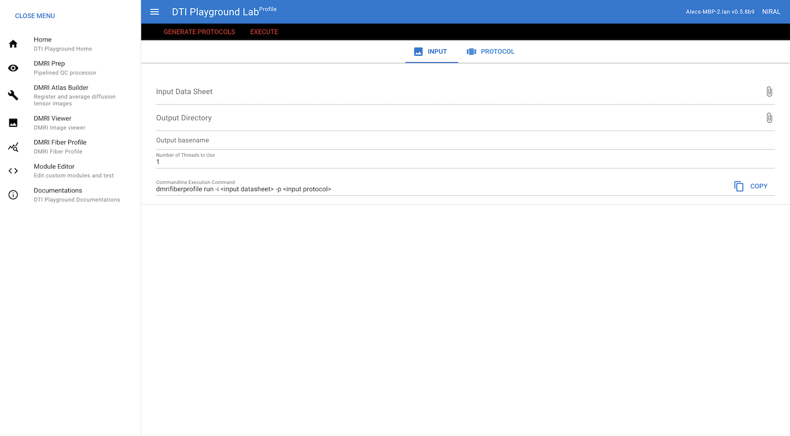
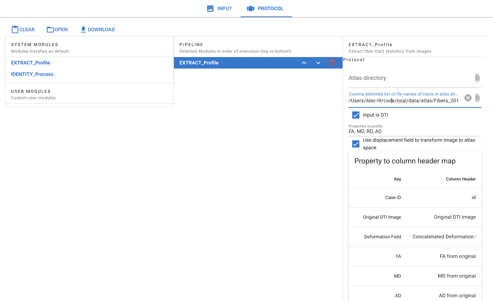

================
DMRIFiberProfile
================

dmrifiberprofile is a tool that analyzes fiber tracts based on DTI volumes or scalar images.

GUI Mode
====================

DTIPlaygroundLab (Web UI)
~~~~~~~~~~~~~~~~~~~~~~~~~~~~

Run::

    $ dmriplaygroundlab

Then go to the DMRIFiberProfile menu. In the INPUT tab, enter the file path to the input datasheet containing the paths to the images to be analyzed.  You can click the paper clip icon to browse for the file in a GUI. Do the same for selecting the output directory.

Next, click on the PROTOCOL tab to define the pipeline. For tract profile extraction, double-click the EXTRACT_Profile module to add it to the pipeline.

Fill in the fields in the EXTRACT_Profile module protocol. You **must** provide a comma-separated list of VTK files to profile. If an atlas directory is provided, these file paths may be relative (e.g., `tract1.vtk`). If no atlas directory is provided, the file paths must be absolute (e.g., `/proj/NIRAL/users/alecj/fibers/tract1.vtk`).

Check the box for "Input is DTI" if the input images are DTI volumes. If the input images are scalar images, uncheck this box. The program will search for scalar images corresponding to the scalar properties you want to profile.

The "Properties to Column Header Map" allows you to map parameters to the column headers in your input datasheet. Default column headers are provided, but they may not match your CSV. If they don't, you can edit the "Column Header" field. For example, if your case IDs are in a column called "Subject ID," you should enter this in the "Column Header" field for the "Case ID" parameter.

Once you've entered the requisite fields, you can click the GENERATE PROTOCOLS button to generate the protocol file. This file will be saved in the output directory you specified in the INPUT tab.

Finally, click the EXECUTE button to run the pipeline. Alternatively, you can copy the command and run it directly in the terminal.::

$ dmrifiberprofile run -i INPUT_DATASHEET -p OUTPUT_DIR/protocols.yml

CLI Mode (Linux/Windows-WSL)
================================

For Windows users, install WSL2 and linux packages with python 3.9 - 3.12 (3.11 recommended).

1. init - Initialize configuration (Default: `$HOME/.niral-dti/dmrifiberprofile-<version>`)
~~~~~~~~~~~~~~~~~~~~~~~~~~~~~~~~~~~~~~~~~~~~~~~~~~~~~~~~~~~~~~~~~~~~~~~~~~~~~~~~~~~~~~~~~~~~~~~~~~~~~~

init command generates the configuration directory and files with following command. 
One just needs to execute this command only once unless a different configuration is 
needed. If you want to reset the initial configuration directory, you can run init again.::

    $ dmrifiberprofile init

If you want to set different config directory other than default one::

    $ dmrifiberprofile --config-dir my/config/dir init

Once run, `config.yml` and `environment.yml` will be in the directory. 

You can manually specify the tool directory (which is generated by `install-tools` command) by `--tools-dir` option.::

    $ dmrifiberprofile init --tools-dir <path/to/tool_dir>

2. update - Update if `config.yml` has been changed (e.g. in case of adding user module directory).
~~~~~~~~~~~~~~~~~~~~~~~~~~~~~~~~~~~~~~~~~~~~~~~~~~~~~~~~~~~~~~~~~~~~~~~~~~~~~~~~~~~~~~~~~~~~~~~~~~~
Changing `config.yml` file should be followed by updating `environment.yml` with running update command ::

    $ dmrifiberprofile [--config-dir my/config/dir] update

This will update module-specific informations such as binary locations or package location used by the corresponding module. It simply updates `environment.yml`

3. make-protocols - Generating a default protocol file
~~~~~~~~~~~~~~~~~~~~~~~~~~~~~~~~~~~~~~~~~~~~~~~~~~~~~~

The first thing to do is generate the default protocol file that has pipeline information::

    $ dmrifiberprofile [base options] make-protocols -i INPUT_DATASHEET  [-o OUTPUT_DIRECTORY] [-d MODULE1 MODULE2 ... ]

if `-o` option is omitted, the output protocol will be printed on terminal.`-d` option specifies the list of modules for the analysis,
with which command will generate the default pipeline and protocols of the sequence. Same module can be used redundantly. If `-d` 
option is not specified, the default pipeline will be generated from the file `protocol_template.yml` . You can change the default 
pipeline in `protocol_template.yml` file.

By default, the only module that will run is `EXTRACT_Profile` which extracts the profile of the fiber tracts provided.

Modifying the default protocol
--------------------------------
If using the `EXTRACT_Profile` module, the default protocol file has two fields that define the tracts, null by default.

1. `atlas` - The directory containing the tracts to be profiled. Must be provided as an absolute path (or with `run --atlas`).
2. `tracts` - The list of tracts to be profiled. Must be provided as a comma-separated list of file names (spaces don't matter), including the .vtk extension. These file names will be concatenated with the path specified by `atlas` to form the full path to the tracts. If empty, all the tracts (`.vtk`) of the `atlas` directory are profiled.

Optionally, you can also leave the `atlas` field blank and provide a list of absolute file paths in the `tracts` field.

If you try to use this protocol without providing an atlas or tracts, you will receive an error message.

Anatomy of EXTRACT_Profile protocol
-----------------------------------
Below are the options contained in the `EXTRACT_Profile` protocol.

.. code-block:: yaml

    protocol:
        atlas:
            type: directory
            default_value: null
            description: Directory containing a set of fiber tracts in the atlas to be analyzed.

        tracts:
            type: string
            default_value: null
            description: Selected set of tracts to use. Comma-delimited list of file names with .vtk extension included. Each entry must uniquely map to a VTK fiber file in the atlas location.

        inputIsDTI:
            type: boolean
            default_value: true
            description: Specifies whether the input image is a DTI, and properties are derived from it.

        propertiesToProfile:
            type: list
            default_value: FA, MD, RD, AD
            description: List of selected properties to profile along tracts.

        useDisplacementField:
            type: boolean
            default_value: true
            description: Determines whether to convert the image to atlas space using a displacement field. If set to false, the image will not be transformed to atlas space.

        parameterToColumnHeaderMap:
            type: dictionary
            default_value: null
            description: Optional map of parameters (e.g., scalar names, case id) to column headers to use for each property to profile.

        resultCaseColumnwise:
            type: boolean
            default_value: true
            description: Specifies whether to store cases as columns instead of rows in the output CSV.

        planeOfOrigin:
            type: string
            candidates:
                - value: Median
                  description: Origin of profile will be median of tract.
                - value: CoG
                  description: Origin of profile will be center of gravity.
            default_value: Median
            description: Determines the plane that sets the origin of the profile arc length.

        stepSize:
            type: integer
            default_value: 1
            description: Specifies how far along the tract to step for each new fiber profile location.

        supportBandwidth:
            type: float
            default_value: 3
            description: Standard deviation (mm) of the Gaussian kernel; points within this distance of a sample are averaged.

        noNaN:
            type: boolean
            default_value: false
            description: Specifies whether to remove fibers with NaN values, used both for FiberPostProcess and DTITractStat.

        mask:
            type: file
            default_value: null
            description: Optional mask file to use during profile extraction. The mask has to be defined in atlas space.

Here's an example of what the `EXTRACT_Profile` protocol might look like with the `atlas` and `tracts` fields filled in:

.. code-block:: yaml

    protocol:
      atlas: /proj/NIRAL/users/alecjn/test_scripts/DTIPlayground-Tests/tests/input/fiberprofile/atlas
      inputIsDTI: true
      mask: null
      noNaN: false
      parameterToColumnHeaderMap:
        FA: FA for original
        Original DTI Image: Original DTI
      planeOfOrigin: Median
      propertiesToProfile: FA, MD
      resultCaseColumnwise: true
      stepSize: 1
      supportBandwidth: 3
      tracts: Arc_L_FrontoParietal-2_extracted_done.vtk, Corpus_Callosum-2_extracted_done.vtk
      useDisplacementField: true

4. run - Run pipeline
~~~~~~~~~~~~~~~~~~~~~~~~~
To run with existing protocol file::

    $ dmrifiberprofile run -i INPUT_DATASHEET -p PROTOCOL_FILE -o OUTPUT_DIR

PROTOCOL_FILE is the file generated by `make-protocols` command and appropriately populated with the necessary information.

Instead of a datasheet, `-i` can be a folder: the files of every scan below it are detected (grouped by case id, the
part of the file names before `_dwi`) and written to `OUTPUT_DIR/datasheet_detected.csv`, and the column map of the
protocol is set to match::

    $ dmrifiberprofile run -i DATA_FOLDER -p PROTOCOL_FILE -o OUTPUT_DIR

With `useDisplacementField: true` (native space) each scan needs its tensor (`<id>_dwi[_QCed]_tensor.nrrd` or
`<id>_dwi[_QCed]_DTI.nrrd`) and displacement field (`..._GlobalDisplacementField.nrrd` or
`..._DTI_DisplacementField.nrrd`); with `false` (atlas space) its registered tensor (`..._DeformedDTI.nrrd` or
`..._DTI_Registered.nrrd`). The maps of the other properties (e.g. `..._NODDI_NDI.nii.gz`, `..._Registered_NDI.nii.gz`)
are optional. The run stops with an error listing the known file names if no scan matches. To check the detected
datasheet first::

    $ dmrifiberprofile make-datasheet DATA_FOLDER -p PROTOCOL_FILE -o datasheet.csv

Without a protocol file, the defaults of EXTRACT_Profile are used; `--atlas` sets the atlas folder, and without
`tracts` all the tracts (`.vtk`) of the atlas folder are profiled::

    $ dmrifiberprofile run -i DATA_FOLDER --atlas ATLAS_FIBERS_FOLDER -o OUTPUT_DIR

With `cleanup: noCleanup` (the default), the profile of each scan, tract and property (`.fvp`) is kept with the
settings and input files it was computed from; a later run into the same output folder reuses the unchanged ones and
only computes the others (e.g. added scans). With `duringProcessing` or `endOfProcessing` everything is recomputed.

Analysis and QC of the profiles
===============================

Besides running the EXTRACT_Profile pipeline (``dmrifiberprofile run``), ``dmrifiberprofile`` provides the tools that
analyse and QC the profiles, ported from the FiberProfileAnalysis scripts. ``dmrifiberprofile <command> --help``
lists all the options of each.

``flip-tensor``
    Reflect the tensor frame of a DTI NRRD along axes, for tensors whose components don't match the frame of their
    header; ``--voxel-frame`` rotates components stored in the frame of the voxel axes.

``detect-tensor-flip``
    Find the correction of the tensor frame that orients a DTI correctly, by the coherence of the principal
    directions along the tracts and, with ``--reference``, their agreement with an atlas tensor.

``parametrize-fibers``
    Resample fiber tracts on the arc length grid and store the arc lengths in the fibers, so that the atlas defines
    them once; replaces ``dtitractstat -f``.

``compute-axis``
    1D axis of the tracts (the average curve per arc length bin), used by ``impute-profiles``.

``gather``
    Collect the profiles of several runs into one table per tract and metric,
    ``<tract>/<tract>_<metric>.csv`` (rows: arc length, columns: the scans).

``impute-profiles``
    Impute the missing values of profile tables (e.g. the cleaned profiles of ``qc-profiles``) from the observed
    values of the same scan, using the 3-D positions of the tract axes: linear along the profile, linear or nearest
    neighbours in 3-D, or a SIREN per scan; ``--validate`` compares them on hidden values. See
    `Imputing the profiles`_.

``qc-registration``
    QC of the registration of the subjects to the atlas: similarity of the deformed metric maps, angular error, CSF
    check and an age conditional normative model, with a combined outlier flag. ``--build-normative`` builds that
    model from a reference cohort, including the mean tensor of each age bin that DTI_Register can register to.

``qc-profiles``
    Age binned statistics of the profiles (``<tract>/<tract>_<metric>_agebinstats.csv``) and their plots, and the QC
    of the profiles against prior (normative) statistics, which flags the profiles whose values leave the normative
    envelope or whose shape doesn't follow it.

A typical sequence, from the parametrized atlas fibers to the cleaned profiles::

    $ dmrifiberprofile parametrize-fibers Atlas/FibersRaw -o Atlas/FibersParam
    $ dmrifiberprofile gather --profiles-dir Output_Profiles --fibers-dir Atlas/FibersParam --out-dir Profiles
    $ dmrifiberprofile compute-axis Atlas/FibersParam -o FiberAxis
    $ dmrifiberprofile qc-registration --data-dir Data --atlas-dir Atlas --normative-dir Atlas/normativeModel --out-dir RegistrationQC
    $ dmrifiberprofile qc-profiles --profiles-dir Profiles --prior-stats-dir Atlas/normProfiles --registration-qc RegistrationQC --clean-dir Profiles_Clean -o ProfileQC
    $ dmrifiberprofile impute-profiles --profiles-dir ProfileQC/Profiles_Clean --axis-dir FiberAxis --out-dir Profiles_Imputed

The imputation comes after the QC, so that the QC sees only measured values.

What qc-profiles reads
~~~~~~~~~~~~~~~~~~~~~~

``--profiles-dir`` takes the tables of ``gather`` (``<tract>/<tract>_<metric>.csv``) or, without gathering them
first, the profiles of a single run as EXTRACT_Profile writes them
(``<output>/<datasheet>/00_EXTRACT_Profile/<metric>/<tract>_<metric>.csv``, in either orientation), so one run can be
QCed on its own. ``--prior-stats-dir`` takes either layout as well, since the age bin statistics are written next to
the tables they were computed from.

The profiles are compared with the prior at their own arc lengths: arc lengths that differ from the prior's only by
rounding (by less than 1% of its spacing) are the same position, and profiles sampled at other arc lengths get the
prior interpolated linearly between its two neighbouring positions (a warning names those tables). Positions beyond the
range of the prior are not compared. If no profile can be compared with the prior (no arc length in common, or no
prior statistics for the tracts or age bins of the profiles), qc-profiles stops with an error instead of reporting no
outliers.

The age of a profile
~~~~~~~~~~~~~~~~~~~~

The age decides the age bin of a profile. It is the row of the scan in ``--age-csv``, a participants / sessions table
(``--age-column`` and ``--age-units`` describe its age column), else ``--age-regex`` on the column name of the
profile, ``ses-(\d+)m`` by default. The same table is used by ``qc-registration --age-csv`` and by the ``ageCSV``
option of the DTI_Register module of dmriprep. Profiles with neither are named at the end of the run, as they take
part in no age bin: they are not QC'd against the prior, and they stay in the summaries and the cleaned profiles.
``--exclude-no-age`` excludes them instead: they are left out of the summaries and the cleaned profiles and listed in
``excluded_cases.csv`` with the reason ``no age``.

Ages are kept as fractional months (an age of 1.5 years in the table is 18 months). The age bins are written in whole
months (``--bins 0-3,4-9,10-60``): a bin ``lo-hi`` holds the ages from ``lo`` up to, not including, ``hi + 1`` months,
so 3.5 months is in ``0-3m``. The tables of ``--stats-dir`` give the age of every scan in the column
``age_<units>``, in ``--age-units`` (``age_months`` by default; ``--age-units years`` for a table in years gives
``age_years``). ``qc-registration`` writes the age of each session in ``registration_qc.csv`` the same way.

Locations sampled outside the brain
~~~~~~~~~~~~~~~~~~~~~~~~~~~~~~~~~~~

A metric that cannot be 0 in tissue (FA, MD, RD, AD, NDI, ODI, ...) is 0 at a position where the fibers of that scan
left the brain mask. That is a property of the location, so it is read as missing on every metric of that tract and
case, including those where 0 is a valid measurement (``--zero-valid-metrics``, the free water fraction by default);
``--keep-outside-brain`` keeps them, and with ``--clean-dir`` those cells are written empty in the cleaned tables. A
profile with less than ``--min-valid-frac`` (0.75) of its positions left is flagged as an outlier, since too little
of it is there to judge.

What qc-profiles writes
~~~~~~~~~~~~~~~~~~~~~~~

The output folders are in the ``-o`` folder (``--plots-dir``, ``--stats-dir``, ``--clean-dir`` and
``--clean-plots-dir`` are folders in it unless they are absolute paths), or in the working directory without ``-o``:

- next to the tables it read: ``<tract>/<tract>_<metric>_agebinstats.csv``, the age-bin statistics (the
  ``--prior-stats-dir`` of later QC runs)
- ``--stats-dir`` (``Profiles_Stats``), the tables of the QC: ``summary_mean.csv`` and ``summary_median.csv``, the
  whole-tract mean and median of every metric per tract and dataset of the cleaned data (with ``--clean-dir``), and
  ``summary_mean_all.csv`` / ``summary_median_all.csv`` before the profile outliers are removed;
  ``excluded_cases.csv`` (one row per registration, preprocessing, no age (``--exclude-no-age``) or profile exclusion),
  ``profile_qc_mean.csv`` (every profile compared with the prior, with the outlier decision of its tract and scan) and
  ``profile_qc_mean_clean.csv`` (the comparison on the cleaned data); ``batch_shifts_mean.csv`` with ``--envelope-batch-correct``. ``mean`` is
  ``--corr-reference``.
- ``--clean-dir``: the cleaned tables, in the layout of ``--profiles-dir``, with their age-bin statistics
- ``--plots-dir`` (``StatPlots``) and ``--clean-plots-dir`` (``StatsPlots_Clean``): ``Plots/``, the plots of all the
  data and of the cleaned data

The tables of ``Profiles_Stats``
~~~~~~~~~~~~~~~~~~~~~~~~~~~~~~~~

All of them are CSV files in ``--stats-dir`` (``Profiles_Stats``). ``<ref>`` in a name is ``--corr-reference``
(``mean`` by default, else ``median``). A scan is identified by the column name of its profile,
``<subject>_<session>_<prefix>`` (``dataset`` or ``subject_session`` below, e.g. ``sub-1007_ses-012m_dwi``). Ages are
floats in ``--age-units``, in a column named after them (``age_months`` by default, ``age_years`` with
``--age-units years``); a scan without an age has it empty. ``bin`` is the age bin of the scan (``--bins``, e.g.
``10-60m``).

.. list-table::
   :header-rows: 1
   :widths: 28 32 40

   * - File
     - Written
     - One row per
   * - ``summary_mean_all.csv``, ``summary_median_all.csv``
     - always
     - tract and scan, before the profile outliers are removed
   * - ``summary_mean.csv``, ``summary_median.csv``
     - with ``--clean-dir``
     - tract and scan of the cleaned profiles
   * - ``profile_qc_<ref>.csv``
     - with ``--prior-stats-dir``
     - tract, metric and scan compared with the prior, with the outlier decision
   * - ``profile_qc_<ref>_clean.csv``
     - with ``--prior-stats-dir`` and ``--clean-dir``
     - tract, metric and scan of the cleaned profiles compared with the prior
   * - ``batch_shifts_<ref>.csv``
     - with ``--envelope-batch-correct``
     - metric and age bin
   * - ``excluded_cases.csv``
     - when a scan is excluded
     - exclusion

**summary_mean_all.csv, summary_median_all.csv, summary_mean.csv, summary_median.csv** -- the whole-tract value of
every metric: the mean (or median) of the profile along the arc length, ignoring missing positions and those sampled
outside the brain. The ``_all`` tables hold every scan except those removed up front (``--registration-qc``,
``--prep-qc``, ``--exclude-no-age``); the others hold the cleaned profiles, without the profile outliers either.

- ``tract``, ``dataset``; ``sub``, ``ses``, ``prefix``: the parts of ``dataset`` (without ``sub-`` / ``ses-``)
- ``age_<units>``
- one column per metric (``fa``, ``md``, ``rd``, ``ad``, ...)

**profile_qc_<ref>.csv** -- the comparison of each profile with the prior statistics of its tract, metric and age
bin (``--prior-stats-dir``), at the arc lengths of the profile (see above). Profiles without an age, or of a tract,
metric or age bin without prior statistics, have no row.

- ``tract``, ``metric``, ``subject_session``, ``age_<units>``, ``bin``
- ``r``: Pearson correlation of the profile with the prior mean (``--corr-reference median``: the prior median) along
  the arc length. It measures the shape, so a shift or a scaling of the values does not change it. Empty when there
  is nothing to correlate (fewer than 3 positions in common with the prior)
- ``frac_inside``: ``n_inside / n_valid``, the fraction of the positions inside the envelope of the prior, ``mean ±
  k·std`` (``--value-nsd``, 3) or the ``--value-pct-lo`` .. ``--value-pct-hi`` percentile band
  (``--value-envelope percentile``); with ``--envelope-batch-correct`` the profile is corrected by the batch shift
  first. Empty when there is no envelope (an age bin of the prior with a single subject has no std)
- ``n_valid``: positions where the profile and the envelope both have a value; ``n_inside``: those inside the envelope
- ``n_present``: positions where the profile has a value (not missing, not outside the brain); ``n_positions``:
  positions of the arc length grid

The outlier decision is made once per tract and scan from all its metrics, and applies to all of them (a flagged scan
is removed from every metric of that tract in ``--clean-dir``), so the following columns have the same value on the
rows of the metrics of a tract and scan (the rows of one metric, e.g. ``metric == fa``, give one row per tract and
scan):

- ``joint_frac_inside``: the fraction of the positions inside the envelope over the metrics of the tract, except
  ``--outlier-exclude-metrics`` (``FWF``): the sum of their ``n_inside`` over the sum of their ``n_valid``
- ``joint_frac_valid``: how much of the profile is there over those metrics, the sum of ``n_present`` over the sum of
  ``n_positions``
- ``is_value_outlier``: ``joint_frac_inside`` below ``--value-min-inside`` (0.9), or ``joint_frac_valid`` below
  ``--min-valid-frac`` (0.75: too little of the profile is left to judge it)
- ``shape_r``: ``r`` of the ``--shape-metric`` (``fa``)
- ``is_shape_outlier``: ``shape_r`` below ``--corr-min`` (0.5), or with ``--shape-outlier-method iqr`` below
  ``Q1 - k·IQR`` of the ``shape_r`` of the tract and age bin (``--corr-iqr-k``, 1.5)
- ``is_outlier``: ``is_value_outlier`` or ``is_shape_outlier``

Up to version 0.8.14 the decision was also written to ``outliers_<ref>.csv``, one row per tract and scan; a run
removes that table from ``--stats-dir`` when it finds one.

**profile_qc_<ref>_clean.csv** -- the columns of ``profile_qc_<ref>.csv`` up to ``n_positions``, for the cleaned
profiles: how the scans that are kept compare with the prior. No decision is made on them.

**batch_shifts_<ref>.csv** -- the shift between the cohort and the prior used by ``--envelope-batch-correct``, per
metric and age bin. It is estimated from all the tracts: for each profile, the median along the arc length of its
difference to the prior median (``value - prior``), or of its ratio for the metrics of ``--batch-mult-metrics``
(``md,rd,ad``: ``value / prior``); the shift is the median of those over the profiles. A profile is corrected by
subtracting the shift (or dividing by it) before the envelope check; the shape check is not affected. The table only
has the header line when no shift can be estimated (the run then warns).

- ``metric``, ``bin``
- ``kind``: ``add`` or ``mul``
- ``shift``: the offset (``add``) or the ratio (``mul``)
- ``n_profiles``: the number of profiles it was estimated from

**excluded_cases.csv** -- one row per exclusion, written when a scan is excluded.

- ``sub``, ``ses``, ``prefix``: the scan (without ``sub-`` / ``ses-``); ``prefix`` is empty for a registration
  failure of a whole session
- ``age_<units>``
- ``tract``: the tract of a profile outlier; empty for the other reasons, which apply to every tract
- ``reason``: ``registration`` (flagged in ``--registration-qc``), ``preprocessing`` (``--prep-qc``), ``no age``
  (``--exclude-no-age``) or ``profile`` (``is_outlier`` in ``profile_qc_<ref>.csv``)

Imputing the profiles
~~~~~~~~~~~~~~~~~~~~~

``impute-profiles`` fills the missing values of profile tables, typically the cleaned profiles of ``qc-profiles``
(``Profiles_Clean``). It reads every layout ``qc-profiles`` reads and writes the same layout to ``--out-dir``
(``Profiles_Imputed``); the observed cells are copied verbatim, so the tables can be QCed and analysed like the
others. Two kinds of values are missing, and both are imputed the same way:

- blank cells, e.g. the locations sampled outside the brain, which ``qc-profiles`` writes empty
- whole profiles: a scan that is in the tables of other tracts but not in the table of a tract, e.g. a profile
  ``qc-profiles`` excluded as an outlier. The imputed profile is added to that table.

A scan that is in no table (excluded for its registration, its preprocessing or a missing age) has nothing to impute
from and stays out.

Each scan and metric is imputed from its own observed values only. Every profile location (tract, arc length) has a
3-D position in atlas space, the point of the tract axis at that arc length (``--axis-dir``, from ``compute-axis``;
beyond the ends of an axis, along its first or last segment). The tracts are dense in the brain, so a location that
is missing has observed neighbours in other tracts of the same scan. The methods (``--method``):

``arc-linear`` (default)
    Linear along the arc length of the same profile, between the observed values at both ends of a gap; gaps longer
    than ``--max-gap`` mm (default 15, the longest gaps validated) are left. The missing start or end of a profile (``--arc-ends``): left
    (``none``, default), the nearest observed value repeated (``constant``), or the line through the 3 nearest
    observed values extended (``linear``), up to ``--max-gap`` mm. It can't fill a whole profile and needs no axes.

``linear``
    Linear in 3-D: barycentric interpolation in the tetrahedra (Delaunay) of the observed positions of the same metric,
    in all tracts. A location outside them is left (``--fallback knn`` fills it).

``knn``
    The mean of the ``--k`` (default 1) nearest observed positions in 3-D, weighted by the inverse of their distance
    (``--knn-weights uniform``: equally).

``siren``
    A sine network (SIREN) per scan, trained on the scan's observed values of all metrics jointly, each standardized
    on its own; it predicts the missing ones. ``--siren-inputs`` sets what it sees of a location: the 3-D position
    (``xyz``), with the arc length (``xyz+arc``), or with the tract (``xyz+tract``, default; a one-hot code). Uses a
    GPU when there is one (``--device``); ``--epochs`` (default 1000), ``--omega0`` (default 30),
    ``--hidden-layers``, ``--hidden-width``, ``--lr``, ``--seed``. The defaults are the best setting for gaps; for
    whole profiles, ``--siren-inputs xyz --omega0 10 --epochs 100`` did best.

The defaults impute only the gaps inside the profiles (``arc-linear``, ``--arc-ends none``, ``--fallback none``):
in the validation on a normative cohort (`Validation of impute-profiles <ImputeValidation.html>`_), every method
that uses only the scan's own values imputed missing starts and ends no better than the cohort mean at each
location, and whole profiles and regions about twice as far off. Imputing them (``--arc-ends``, ``--fallback``,
another ``--method``) is possible, but those values are estimates of limited use.

``--fallback`` runs a second method on the cells the first one left, from the observed values as well (e.g.
``--method arc-linear --fallback siren``: gaps along the profile, the rest from the network). Limits:

- ``--max-distance`` (mm, default 10; 0: none): the 3-D methods fill only cells within that distance of an observed
  position of the same metric
- ``--min-observed`` (default 0.5): a metric of a scan with a smaller share of observed values is not imputed

Next to the tables, ``--report-dir`` (default ``<out-dir>_report``) holds:

- ``masks/``: the tables again, with 1 for an imputed cell, 0 for an observed one and blank for one still missing,
  so the analyses can tell measured values from imputed ones
- ``imputation_summary.csv``: one row per scan, tract and metric with missing values: ``n_positions``,
  ``n_observed``, ``n_missing``, ``shape`` (``whole profile``, or ``end gap`` for a missing start or end and
  ``gap`` for missing values inside the profile), ``n_imputed``, ``n_left``, ``methods``,
  ``max_distance_mm`` (the largest distance from an imputed cell to an observed position) and ``left_reason``
- ``imputation_settings.json``: the options of the run

Imputed values are estimates, not measurements: report the share of imputed values, and consider leaving them out
of analyses that handle missing values themselves (e.g. mixed models).

Validation
----------

``--validate`` compares the methods and their settings on values that were measured: in a sample of scans
(``--validate-scans``, default 30, chosen with ``--validate-seed``) it hides whole profiles of a share of the tracts
(``--validate-whole-fraction``, default 0.1, all metrics of the tract), one gap inside the profile in a share of the
other tracts (``--validate-gap-fraction``, default 0.2; ``--validate-gap-mm``, default 3 to 15 mm long) and the
start or end of the profile in another share (pattern ``end gap``; ``--validate-end-gap-fraction``, default 0.2;
``--validate-end-gap-mm``, default 1 to 8 mm, like the missing ends of real profiles), imputes them with every setting
and compares with the hidden values. Those tracts are chosen at random, so their neighbours are usually
observed. A regional artifact (signal dropout, susceptibility, motion) instead makes ``qc-profiles`` reject all the
tracts that run through the same region, and takes away the neighbours the 3-D methods rely on. A second pass per
scan hides such a region (pattern ``region``): every tract with a position inside a sphere around a random observed
position loses its whole profile (``--validate-region-mm``, radius 10 to 25 mm by default; a sphere reaching more
than half of the scan's tracts is drawn again; ``--validate-region-count``, default 1, 0: no region pass).
``--validate-rounds`` (default 1) repeats both passes on every scan with other tracts, gaps and regions, for more
hidden values per location. Only scans whose metrics are at least
``--min-observed`` observed are used. Nothing is imputed into ``--out-dir``; the results are in
``<report-dir>/validation``:

- ``validation_summary.csv``: per setting and pattern (``gap``, ``end gap``, ``whole profile``, ``region``) the share of hidden values
  filled (``coverage``) and the error, as an RMSE normalized by the between-scan SD at each location (``nrmse``; 1
  is as far off as a scan typically is from the cohort mean there), its SD over the SIREN seeds, and
  ``nrmse_common``, the error on the cells every setting filled (of the settings that fill any of the pattern, so
  without ``arc-linear`` for whole profiles and regions). The errors are averaged over the metrics, so each counts the same. The between-scan SD of a
  location is at least a quarter of the metric's median SD over all locations, so a location where a metric hardly
  varies (e.g. the free water fraction in deep white matter) doesn't dominate. The row ``cohort mean (reference)``
  is not a method: it imputes the mean of the other scans at each location, so it shows what an error of a method
  means (``--no-validate-reference``: left out). Over a sample of scans its error is near 1 but not exactly: the
  scans sampled may lie closer to the cohort mean, or farther, than the cohort as a whole. ``vs_reference`` is
  therefore the error of a setting relative to that of the reference on the same cells: below 1, the setting does
  better than the cohort mean, whatever the sample. It is in every table but the one per location
- ``validation_by_metric.csv``, ``validation_by_tract.csv``: the same per metric and per tract and metric, also in
  the units of the metric (``rmse``); the second one has the distance from the tract's axis to the nearest other tract
- ``validation_by_location.csv``: the error at every profile location (tract, arc length and its 3-D position
  ``x``, ``y``, ``z``) of the best setting of each method for each pattern (``--validate-location-settings all``:
  of every setting), per metric and as the mean over the metrics (``metric`` ``all``), with the number of hidden values
  there (``n_hidden``); it shows whether some locations are harder to impute than others
- ``error_maps/<setting>.vtk``: the same on the tract axes, one polyline per tract at the profile locations, with
  the point data ``gap_n``, ``gap_nrmse``, ``gap_nrmse_<metric>`` and the same for ``end``, ``whole`` and ``region``
  (NaN where nothing was hidden); open it with the atlas tracts (e.g. in 3D Slicer or ParaView) and color by an error
- ``error_maps/<setting>.png``: the error per location (mean over the metrics) in three projections (axial, coronal, sagittal), per
  pattern; the largest errors are drawn on top, and locations with fewer than ``--validate-min-n`` (default 3)
  hidden values are gray
- ``validation_by_distance.csv``: the error by the distance from a hidden value to the nearest position still
  observed in that scan (bins 0-2, 2-4, 4-6, 6-10, 10-15, 15-25, over 25 mm), per setting, pattern and metric and
  their mean (``all``); it shows how fast a method degrades as the observed neighbours get farther away
- ``axis_proximity.csv``: per tract, the distance from its positions to those of the nearest other tract (where the
  3-D position alone can't tell the tracts apart)
- ``validation_siren_epochs.png``: the error of every SIREN setting against the epochs, with the other methods as
  lines
- ``validation_settings.json``: the scans used and the settings

The settings compared: ``--validate-methods`` (default all), ``--validate-k`` (``knn``, default 1,3,5,10,20,50) with
``--validate-knn-weights`` (default both, ``distance`` and ``uniform``), ``--validate-arc-ends`` (``arc-linear``,
default all three) and for
``siren`` the grid of ``--validate-siren-inputs`` (default all three), ``--validate-omega0`` (default 5,10,20,30)
and ``--validate-epochs`` (default 100,200,500,1000; one training per setting, read off at each value), each trained
``--validate-seeds`` times (default 3). ``arc-linear`` fills every hidden gap and end there, whatever its length. The other
limits (``--max-distance``, ``--min-observed``) apply as in an imputation. With the default grid a scan takes about a
minute on a GPU.

See the `README <https://github.com/NIRALUser/DTIPlayground/blob/master/README.md>`_ for the remaining options.

Development of a new module
===========================

Adding a module
~~~~~~~~~~~~~~~

Once initialized, users can add their custom module from scratch or existing system/user modules by following command::

    $ dmrifiberprofile add-module <module-name> [--base-module <base-module-name>] [--edit]

Following command will generate initial skeletal files of module::

    $ dmrifiberprofile add-module HELLO_World

Then you can test if the module can be loaded properly with::

    $ dmrifiberprofile update

You can use your module right in protocol file.

if `-b` , `--base-module` is specified, new model will copy existing code and data from the base module.
e.g.::

    $ dmrifiberprofile add-module MYFIRST_Module -b EXTRACT_Profile

MYFIRST_Module will have same codes and data (module definition yaml file) from EXTRACT_Profile module with new classname and filenames.

Developer
~~~~~~~~~

Once module is developed and tested in 
the user module directory, one can just
move that directory in `dtiplayground/dmri/fiberprofile/modules` and commit.
Make sure the custom module does not exist in both the user and system module directories.

Removing user module
~~~~~~~~~~~~~~~~~~~~

User module can be removed by::

    $ dmrifiberprofile remove-module <module-name>

e.g.::
    
    $ dmrifiberprofile remove-module MYFIRST_Module

[NOTE] System module cannot be removed by this command. Only user module can be removed.

Modules in other directory
~~~~~~~~~~~~~~~~~~~~~~~~~~
You can just copy module directory to `$HOME/.niral-dti/modules/dmrifiberprofile` and check with 
`$ dmrifiberprofile update` command. Same applies for removal of user modules.

