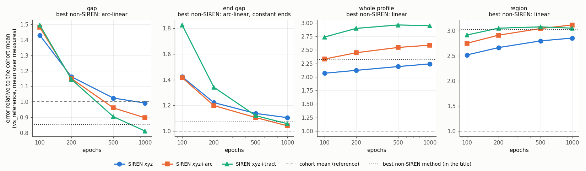
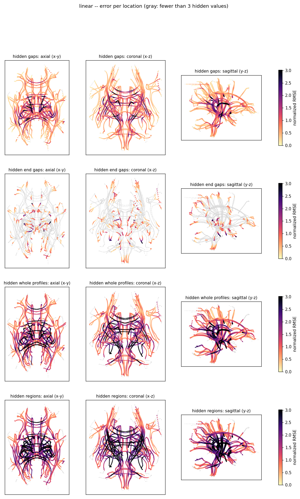

Validation of impute-profiles
=============================

This page documents the validation of ``dmrifiberprofile impute-profiles`` with ``--validate`` (see
`Imputing the profiles <DMRIFiberProfile.html#imputing-the-profiles>`_ for the command and its outputs) on a normative
infant cohort, in phases: every method imputing a scan from its own observed values (phase 1, 2026-10-15),
from its deviations from the age-bin norm (phase 2, 2026-10-16), with a population model of the normative cohort
(phase 3, 2026-10-16), and with continuous age norms and a second cohort pooled with a batch correction (phase 3b,
2026-10-22), and with a graph U-Net after CONFETTI (phase 4, 2026-10-28). The results set the defaults of the
command.

Phase 4: summary
----------------

Phase 4 (2026-10-28) adds a graph U-Net after `CONFETTI <https://github.com/styner/CONFETTI>`_ (``graph-unet``):
a multi-resolution neighbourhood graph over the profile locations and a hierarchical graph convolutional network,
trained on the normative cohort to predict hidden deviations from the observed ones.

- **As CONFETTI builds it, it imputes poorly**: with CONFETTI's graph (the edge threshold from the dense atlas fibers,
  7.7 mm, about 9.5 edges per location) and network (64 features, one convolution per level, no global summary of
  the scan), its error was 0.90 of the age-bin mean's overall, against 0.69 for the population model alone and 0.57
  for the default. CONFETTI classifies whole scans; for values at single locations three changes mattered:
- **a graph from the axes** (the threshold from the nearest axis of another tract, 3.6 mm, 3.9 edges per location):
  the fiber graph links each location to too many other tracts (held-out gaps 0.74 against 0.62 of the age-bin
  mean's error);
- **a global context**: the mean and max of the coarsest level over the scan, added to each node there (as the global
  pooling of the CONFETTI classifier); without it regions were 0.91 instead of 0.77, a whole measure 0.57 instead of
  0.46;
- **the population prediction as an input** (hybrid, ``--graph-hybrid 80``): the network corrects the prediction of
  the population model, which a training scan gets from a model fitted without its subject. Alone it is then better
  than the population model for every pattern (0.638 against 0.688 overall, 3 seeds) and for a whole missing measure
  a third better (0.43 against 0.63), but it does not reach the default (SIREN on the population residuals within
  4 mm), which is better for gaps and ends (0.41 against 0.56).
- **The combination**: the default within 4 mm, the hybrid U-Net beyond instead of the population prediction
  (``--fallback graph-unet``). Over 3 seeds its error is 0.995 of the default's on the four patterns (paired per scan,
  p = 8e-6, better on 65% of the scans) and 0.65 of it for a whole missing measure (better on every scan). The gain is
  small where the scan has its measures and large where it lacks one; ``--fallback population`` stays the default
  (no training of a network, about 10 minutes on a GPU), ``--fallback graph-unet`` is recommended for cohorts with
  missing free water or NODDI fits.
- **SIREN on the residuals of the U-Net** needs residuals of a prediction: the network copies an observed value with
  a small SD, so the observed values are predicted cross-fitted (each fifth of the tracts with its own values hidden).
  Even so SIREN on its residuals (0.623) stays behind SIREN on those of the population model.
- **SDs**: calibrated per metric on held-out subjects, 95% of the errors of the U-Net were within 1.96 SD (rms of
  error / SD 1.00).

Phase 4: setup
--------------

- **Data, scans, patterns and score**: those of phase 3b, BCP alone (423 scans, the diffusivities range checked):
  20 scans per age bin, at most half of a bin (14, 20 and 20), 3 rounds, seeds 0, 1 and 2 (162 scan x seed pairs);
  the RMSE relative to the age-bin mean on the same hidden values, the mean over the 11 measures and the four
  patterns, and the paired comparison per scan.
- **Graph**: level L keeps every 2^L-th location of each tract (the ends and at least 3 kept), 5,388 locations at
  level 0 down to 767 (level 3) and 436 (level 4); edges along the tracts and to the closest location of each other
  tract within 1.5 times the median nearest-neighbour distance; Gaussian edge weights; pooling by the kept locations.
- **Network**: per level graph convolutions (normalized adjacency, BatchNorm, ReLU, dropout 0.1), encoder and decoder
  with skip connections, a per-location head with the mean and log variance of each metric; inputs per location the
  observed deviations (0 where missing), the observed mask, the 3-D position and the arc length, and with the hybrid
  the population prediction and its SD. Trained (AdamW, cosine schedule, batches of 16 scans) with the validation
  patterns hidden anew each epoch (gaps, ends, whole profiles; a region in half of the scans, a whole measure in a
  quarter), the Gaussian likelihood of the hidden values (the visible ones with weight 0.1); 10% of the training
  subjects pick the epoch and calibrate the SDs. In the validation it is fitted per fold, without the validated
  subjects, like the population model.
- **Settings tried** (seed 0): 3, 4 and 5 levels, 64, 128 and 256 features, 1 or 2 convolutions per level, 60 or 200
  epochs. With the hybrid, 60 epochs were better than 200, the sizes within 0.015 of each other alone and the same
  in the combination (0.570); the defaults are 4 levels, 128 features, 1 convolution, 60 epochs.

Phase 4: results
----------------

Development (seed 0, 54 scans)
~~~~~~~~~~~~~~~~~~~~~~~~~~~~~~

Relative to the age-bin mean, mean over the measures; overall: the mean of the four patterns:

.. table::
   :class: longtable

   ==============================================  =====  =======  =============  ======  =======  =============
   setting                                         gap    end gap  whole profile  region  overall  whole measure
   ==============================================  =====  =======  =============  ======  =======  =============
   age-bin mean (prior-mean)                       1.000  1.000    1.000          1.000   1.000    1.000
   population alone, 80 components                 0.638  0.721    0.662          0.717   0.685    0.639
   **population + SIREN (default)**                0.408  0.516    0.642          0.720   0.572    0.639
   graph U-Net as CONFETTI (fiber graph, 64 x 1)   0.882  0.894    0.899          0.920   0.899    0.673
   graph U-Net, fiber graph, 128 x 1               0.855  0.874    0.877          0.903   0.877    0.644
   ... + SIREN (residuals not cross-fitted)        0.998  1.038    0.978          0.986   1.000    0.644
   axis graph, global context, 256 x 1             0.625  0.748    0.738          0.806   0.729    0.464
   hybrid (on the population prediction), 128 x 1  0.563  0.638    0.638          0.701   0.635    0.438
   hybrid, 256 x 2                                 0.543  0.620    0.632          0.699   0.623    0.432
   hybrid 128 x 1 + SIREN                          0.456  0.608    0.688          0.733   0.621    0.438
   **population + SIREN, hybrid beyond**           0.404  0.516    0.647          0.715   0.570    0.438
   ==============================================  =====  =======  =============  ======  =======  =============

Three seeds
~~~~~~~~~~~

Mean over the seeds (SD between seeds), the hybrid with 4 levels, 128 features, 1 convolution:

.. table::
   :class: longtable

   =====================================  =============  =============  =============  =============  =====  =======  =============  ======  =============
   setting                                0-3 months     4-9 months     10-60 months   overall        gap    end gap  whole profile  region  whole measure
   =====================================  =============  =============  =============  =============  =====  =======  =============  ======  =============
   population alone                       0.678 (0.038)  0.677 (0.019)  0.711 (0.036)  0.688 (0.009)  0.640  0.730    0.669          0.715   0.633 (0.009)
   hybrid U-Net alone                     0.620 (0.029)  0.635 (0.011)  0.661 (0.031)  0.638 (0.007)  0.563  0.652    0.640          0.698   0.428 (0.010)
   hybrid U-Net + SIREN                   0.613 (0.018)  0.616 (0.018)  0.639 (0.012)  0.623 (0.009)  0.454  0.608    0.692          0.737   0.428 (0.010)
   **population + SIREN (default)**       0.563 (0.025)  0.567 (0.010)  0.589 (0.020)  0.573 (0.007)  0.409  0.517    0.648          0.718   0.633 (0.009)
   **population + SIREN, hybrid beyond**  0.557 (0.021)  0.568 (0.006)  0.586 (0.018)  0.571 (0.005)  0.405  0.513    0.651          0.714   0.428 (0.010)
   =====================================  =============  =============  =============  =============  =====  =======  =============  ======  =============

Paired per scan
~~~~~~~~~~~~~~~

Ratio to the default (below 1: better), geometric mean over the 162 scan x seed pairs (95% CI), Wilcoxon p and the
share of the scans better:

.. table::
   :class: longtable

   =================================  ========================================  =================================
   comparison with the default        four patterns                             whole measure
   =================================  ========================================  =================================
   population + SIREN, hybrid beyond  0.995 (0.992-0.997) p=8e-6, 65% of scans  0.652 (0.640-0.665) p=3e-28, 100%
   hybrid U-Net + SIREN               1.073 (1.065-1.082) p=3e-27
   hybrid U-Net alone                 1.099 (1.090-1.108) p=7e-28
   population alone                   1.201 (1.193-1.210) p=3e-28
   =================================  ========================================  =================================

Per measure
~~~~~~~~~~~

Relative to the age-bin mean, the four patterns, mean over the seeds:

.. table::
   :class: longtable

   =================================  =====  =====  =====  =====  =====  =====  =====  =====  =====  =====  =====
   setting                            FA     MD     RD     AD     FW-FA  FW-MD  FW-RD  FW-AD  FWF    NDI    ODI
   =================================  =====  =====  =====  =====  =====  =====  =====  =====  =====  =====  =====
   population alone                   0.784  0.660  0.656  0.756  0.682  0.536  0.514  0.725  0.804  0.642  0.814
   hybrid U-Net alone                 0.716  0.629  0.613  0.717  0.623  0.487  0.469  0.651  0.768  0.591  0.758
   population + SIREN (default)       0.661  0.536  0.534  0.637  0.576  0.429  0.419  0.596  0.685  0.525  0.704
   population + SIREN, hybrid beyond  0.654  0.538  0.533  0.637  0.571  0.429  0.418  0.589  0.687  0.524  0.696
   =================================  =====  =====  =====  =====  =====  =====  =====  =====  =====  =====  =====

Phase 4: reproducing
--------------------

Each seed (``--validate-seed 0``, 1, 2) on BCP alone::

    $ dmrifiberprofile impute-profiles --profiles-dir BCP/Profiles_Clean --axis-dir FiberAxis --out-dir G \
        --validate --validate-scans-per-bin 20 --validate-max-share 0.5 --validate-rounds 3 --validate-seed 0 \
        --validate-relative yes --validate-methods prior-mean,population,graph-unet --validate-components 80 \
        --validate-noise isotropic --validate-population-local siren --validate-siren-inputs xyz \
        --validate-omega0 10 --validate-epochs 500 --validate-seeds 1 --max-distance 4 \
        --validate-graph-levels 4 --validate-graph-hidden 128 --validate-graph-convs 1 --validate-graph-hybrid 80 \
        --graph-epochs 60

A run took about 2 hours on one GPU, most of it the 5 fits per fold (5 population models for the training inputs and
the network). Imputing with the combination::

    $ dmrifiberprofile impute-profiles --profiles-dir Profiles_Clean --prior-stats-dir Profiles_Clean \
        --axis-dir FiberAxis --out-dir Profiles_Imputed --fallback graph-unet --fit-graph-model graph.pt

Phase 3b: summary
-----------------

Phase 3b (2026-10-22) adds continuous age norms, the pooling of two cohorts with a batch correction, and the range
check of the diffusivities in ``qc-profiles``, and repeats the validation with 3 seeds and more scans (see `Phase 3b:
setup`_). It changes no default.

- **The default stays the best**: SIREN on the residuals from the population prediction, with the age-bin norm, on
  the cohort alone, 0.573 of the age-bin mean's error overall (SD 0.007 between seeds; 0.563, 0.567 and 0.589 in the
  three age bins).
- **Continuous age norms** (``--age-norm spline`` or ``kernel``, a natural cubic spline or a local-linear kernel
  regression of log(age + 1 month)) are better than the age bins as the only predictor: 0.93 of the age-bin mean's
  error paired per scan (p < 1e-10), 0.88 in 0-3 months, where the norm changes fastest within a bin. The spline
  and the kernel are the same (1.000). Under the population model and SIREN, the norm matters little: kernel and
  bins are the same (1.005, p = 0.44), so ``bins`` stays the default.
- **Pooling a second cohort** (HBCD, 2,293 scans, with a batch correction to BCP) does not improve the BCP scans.
  With the tensor and NODDI measures of HBCD only, the error is the same as with BCP alone (1.010 paired, 95% CI
  0.992-1.027, p = 0.37; FA, AD, MD, RD and ODI 2-6% better, NDI and the free water measures the same). With all
  measures it is 5% worse (p = 2e-6), FW-MD 0.52 instead of 0.43: the free water fits of HBCD differ from BCP's by
  more than a shift and a scale (a shift of 2.5 SD for FW-MD and FW-RD, against 0.8 SD for AD).
- **Failed free water fits** must go first: HBCD has diffusivities far above that of free water (FW-AD in 2,227 of
  its scans, up to 0.46 mm²/s). Pooled as they were, they made the errors of the free water diffusivities of BCP
  hundreds to thousands of times larger. ``qc-profiles --max-diffusivity`` (default 3.6e-3 mm²/s) now drops them as
  single values.
- **A robust batch correction** (``--batch-robust yes``: the diffusivities on the log scale, Huber and bisquare
  weights) was not better than the plain one once those values were dropped (0.947 against 0.935 with the age norm
  alone, one seed), so it is not the default.
- **Seeds**: between seeds the overall score of a setting varies by 0.01 (SD), within an age bin by up to 0.04, more
  than most of the differences between settings in phase 3. Small differences are decided by a paired comparison
  on the same scans (``validation_by_scan.csv``), not by the scores of one seed.

Phase 3b: setup
---------------

- **Data**: the cleaned BCP profiles of phase 3 (423 scans of 208 subjects: 28 scans in 0-3 months, 117 in 4-9,
  278 in 10-60) and, for pooling, those of HBCD (2,293 scans of 1,720 subjects: 1,501, 658 and 133), both checked
  with ``qc-profiles --max-diffusivity 3.6e-3`` (BCP: 132 values dropped in 16 scans; HBCD: about 345,000, mostly
  free water fits).
- **Scans**: 20 per age bin and batch, at most half of the scans of a bin (``--validate-scans-per-bin 20
  --validate-max-share 0.5``): 14, 20 and 20 BCP scans per seed (54), with pooling 20 per bin of HBCD as well;
  seeds 0, 1 and 2 (``--validate-seed``), 131 distinct BCP scans, 162 scan x seed pairs; 3 rounds of hidden values
  per scan, as before. The BCP scans are the same with and without pooling (their hidden values are drawn
  again).
- **Settings**: the age norm alone (``prior-mean``: age bins, spline with 6 or 8 df for the mean and 3 for the
  variance, kernel with the bandwidth by cross-validation), and the default of phase 3 (population, 80 components,
  isotropic, SIREN on the residuals within 4 mm), each with the age bins and the kernel norm; on BCP alone, on BCP
  pooled with the tensor and NODDI measures of HBCD (its free water measures left out: they come from BCP alone),
  and on BCP pooled with all measures of HBCD (plain batch correction, constant shift, ``--batch-scale-limit``
  3,FWAD=10,FWMD=10). The population model, the continuous norms and the batch correction are fitted without the
  subjects validated (5 folds by subject; the batch correction without all of them).
- **Score**: on the BCP scans, in BCP units, the RMSE relative to that of the age-bin mean of BCP alone on the same
  hidden values, the mean over the 11 measures and the four patterns (gap, end gap, whole profile, region). The
  paired comparison averages, per scan, the ratio of the RMSE of each measure and pattern to that of the age-bin
  mean, and compares two settings by the geometric mean of the ratio of those scores over the 162 scan x seed pairs
  (95% CI and the Wilcoxon signed-rank test of the log ratios). Within a run the settings share the hidden values;
  between runs (pooled or not) only the scans.

Phase 3b: results
-----------------

Overall
~~~~~~~

Relative to the age-bin mean, mean over the three seeds (SD between seeds); the last column gives each seed:

.. table::
   :class: longtable

   =================================  =============  =============  =============  =============  =================
   setting                            0-3 months     4-9 months     10-60 months   overall        seeds 0, 1, 2
   =================================  =============  =============  =============  =============  =================
   age-bin mean (prior-mean)          1.000 (0.000)  1.000 (0.000)  1.000 (0.000)  1.000 (0.000)  1.000 1.000 1.000
   kernel age mean                    0.868 (0.065)  0.935 (0.010)  0.933 (0.030)  0.912 (0.020)  0.925 0.889 0.921
   spline 6/3 age mean                0.869 (0.066)  0.933 (0.009)  0.937 (0.030)  0.913 (0.022)  0.926 0.888 0.925
   **BCP alone, age bins (default)**  0.563 (0.025)  0.567 (0.010)  0.589 (0.020)  0.573 (0.007)  0.572 0.566 0.581
   BCP alone, kernel norm             0.598 (0.021)  0.562 (0.011)  0.593 (0.022)  0.584 (0.017)  0.567 0.584 0.602
   pooled tensor+NODDI, age bins      0.546 (0.031)  0.571 (0.014)  0.577 (0.030)  0.564 (0.010)  0.559 0.559 0.576
   pooled tensor+NODDI, kernel norm   0.709 (0.107)  0.567 (0.019)  0.584 (0.030)  0.620 (0.052)  0.561 0.647 0.653
   pooled all measures, age bins      0.549 (0.038)  0.599 (0.006)  0.605 (0.039)  0.584 (0.010)  0.582 0.576 0.595
   pooled all measures, kernel norm   0.561 (0.025)  0.596 (0.014)  0.611 (0.046)  0.589 (0.016)  0.575 0.585 0.607
   =================================  =============  =============  =============  =============  =================

With the kernel norm, pooling with the tensor and NODDI measures of HBCD failed in 0-3 months for seeds 1 and 2 (FWF
0.097 against 0.046): the free water measures then come from 28 BCP scans under 3 months only, and the kernel norm
fitted on the pooled ages is poor there.

Paired per scan
~~~~~~~~~~~~~~~

Ratio of the scores of two settings on the same scans (below 1: the first is better), geometric mean over the scan x
seed pairs (number in the header) with its 95% CI and the Wilcoxon p value:

.. table::
   :class: longtable

   ================================  =============================  =============================  =============================  =============================
   comparison                        all (162)                      0-3 months (42)                4-9 months (60)                10-60 months (60)
   ================================  =============================  =============================  =============================  =============================
   pooled tensor+NODDI / BCP alone   1.010 (0.992-1.027) p=0.37     0.999 (0.966-1.033) p=0.82     1.022 (0.993-1.052) p=0.32     1.004 (0.976-1.034) p=0.58
   pooled all measures / BCP alone   1.051 (1.031-1.072) p=2e-06    1.019 (0.981-1.058) p=0.26     1.075 (1.042-1.109) p=0.00011  1.051 (1.017-1.085) p=0.0027
   pooled all / pooled tensor+NODDI  1.041 (1.034-1.048) p=1.2e-19  1.020 (1.005-1.035) p=0.015    1.052 (1.040-1.063) p=2.9e-10  1.046 (1.037-1.055) p=3.1e-10
   BCP alone: kernel / age bins      1.005 (0.996-1.015) p=0.44     1.025 (0.991-1.061) p=0.82     0.992 (0.986-0.997) p=0.0019   1.006 (1.001-1.011) p=0.041
   age mean: kernel / age bins       0.930 (0.911-0.949) p=9.2e-11  0.880 (0.828-0.936) p=0.00043  0.944 (0.924-0.964) p=1.2e-05  0.952 (0.928-0.976) p=0.00016
   age mean: spline / kernel         1.000 (0.996-1.003) p=0.84     1.002 (0.996-1.009) p=0.35     0.995 (0.990-1.001) p=0.16     1.002 (0.995-1.009) p=0.37
   ================================  =============================  =============================  =============================  =============================

Per measure, relative to the age-bin mean
~~~~~~~~~~~~~~~~~~~~~~~~~~~~~~~~~~~~~~~~~

Mean over the age bins, patterns and seeds:

.. table::
   :class: longtable

   =================================  =====  =====  =====  =====  =====  =====  =====  =====  =====  =====  =====
   setting                            FA     MD     RD     AD     FW-FA  FW-MD  FW-RD  FW-AD  FWF    NDI    ODI
   =================================  =====  =====  =====  =====  =====  =====  =====  =====  =====  =====  =====
   age-bin mean (prior-mean)          1.000  1.000  1.000  1.000  1.000  1.000  1.000  1.000  1.000  1.000  1.000
   kernel age mean                    0.884  0.891  0.866  0.955  0.902  0.881  0.856  0.958  0.985  0.874  0.978
   spline 6/3 age mean                0.886  0.891  0.866  0.956  0.903  0.878  0.853  0.959  0.989  0.878  0.984
   **BCP alone, age bins (default)**  0.661  0.536  0.534  0.637  0.576  0.429  0.419  0.596  0.685  0.525  0.704
   BCP alone, kernel norm             0.659  0.535  0.530  0.643  0.579  0.445  0.433  0.608  0.724  0.550  0.721
   pooled tensor+NODDI, age bins      0.619  0.522  0.517  0.613  0.583  0.437  0.424  0.601  0.688  0.529  0.675
   pooled tensor+NODDI, kernel norm   0.623  0.525  0.521  0.614  0.641  0.530  0.510  0.691  0.964  0.527  0.675
   pooled all measures, age bins      0.631  0.551  0.544  0.635  0.565  0.520  0.443  0.633  0.682  0.533  0.693
   pooled all measures, kernel norm   0.638  0.547  0.541  0.638  0.574  0.523  0.450  0.638  0.700  0.535  0.698
   =================================  =====  =====  =====  =====  =====  =====  =====  =====  =====  =====  =====

Per measure and age bin, absolute RMSE
~~~~~~~~~~~~~~~~~~~~~~~~~~~~~~~~~~~~~~

In BCP units, mean over the four patterns and the three seeds: FA, FW-FA, FWF, NDI and ODI x 1e-3, the diffusivities
x 1e-6 mm²/s.

0-3 months:

.. table::
   :class: longtable

   =================================  =========  ===============  ===============  ===============  ============  ==================  ==================  ==================  ==========  ==========  ==========
   setting                            FA (1e-3)  MD (1e-6 mm²/s)  RD (1e-6 mm²/s)  AD (1e-6 mm²/s)  FW-FA (1e-3)  FW-MD (1e-6 mm²/s)  FW-RD (1e-6 mm²/s)  FW-AD (1e-6 mm²/s)  FWF (1e-3)  NDI (1e-3)  ODI (1e-3)
   =================================  =========  ===============  ===============  ===============  ============  ==================  ==================  ==================  ==========  ==========  ==========
   age-bin mean (prior-mean)          46.0       121.9            122.5            138.6            74.1          96.3                101.5               111.5               63.0        68.1        66.1
   kernel age mean                    36.4       96.1             90.2             127.3            61.0          83.8                83.7                107.6               61.3        61.3        62.4
   **BCP alone, age bins (default)**  28.6       61.9             60.3             89.3             38.3          40.8                38.8                67.6                46.4        38.9        43.9
   BCP alone, kernel norm             28.4       62.4             59.6             91.8             38.5          46.3                43.6                72.1                54.3        43.5        47.1
   pooled tensor+NODDI, age bins      26.1       57.6             55.3             82.2             39.9          43.1                40.5                69.4                46.6        37.0        39.4
   pooled tensor+NODDI, kernel norm   26.6       58.3             56.1             82.4             52.6          71.2                67.8                99.8                97.4        36.5        39.8
   pooled all measures, age bins      26.3       59.0             56.9             83.2             35.1          50.4                40.6                72.9                42.7        36.5        40.9
   pooled all measures, kernel norm   26.8       58.6             56.5             83.7             36.2          51.8                42.0                74.4                46.4        36.8        41.3
   =================================  =========  ===============  ===============  ===============  ============  ==================  ==================  ==================  ==========  ==========  ==========

4-9 months:

.. table::
   :class: longtable

   =================================  =========  ===============  ===============  ===============  ============  ==================  ==================  ==================  ==========  ==========  ==========
   setting                            FA (1e-3)  MD (1e-6 mm²/s)  RD (1e-6 mm²/s)  AD (1e-6 mm²/s)  FW-FA (1e-3)  FW-MD (1e-6 mm²/s)  FW-RD (1e-6 mm²/s)  FW-AD (1e-6 mm²/s)  FWF (1e-3)  NDI (1e-3)  ODI (1e-3)
   =================================  =========  ===============  ===============  ===============  ============  ==================  ==================  ==================  ==========  ==========  ==========
   age-bin mean (prior-mean)          40.5       91.3             87.5             117.7            58.0          61.2                60.5                87.5                51.1        58.8        42.0
   kernel age mean                    39.1       86.9             83.0             114.3            53.8          52.1                50.6                82.1                51.0        53.5        41.9
   **BCP alone, age bins (default)**  28.5       47.0             46.6             70.9             34.7          25.0                24.5                50.8                33.3        31.4        30.8
   BCP alone, kernel norm             28.6       46.5             46.3             70.3             34.6          24.4                24.2                50.2                32.9        31.5        30.5
   pooled tensor+NODDI, age bins      27.2       49.2             48.5             71.3             34.4          25.0                24.4                50.4                33.9        32.1        30.3
   pooled tensor+NODDI, kernel norm   27.2       49.1             48.5             70.7             34.2          24.6                24.1                50.1                33.9        32.0        30.0
   pooled all measures, age bins      27.8       52.3             51.2             74.3             34.6          31.0                26.1                54.1                34.8        32.5        31.0
   pooled all measures, kernel norm   27.8       51.1             50.3             73.9             34.6          31.0                26.1                54.2                33.7        32.5        30.9
   =================================  =========  ===============  ===============  ===============  ============  ==================  ==================  ==================  ==========  ==========  ==========

10-60 months:

.. table::
   :class: longtable

   =================================  =========  ===============  ===============  ===============  ============  ==================  ==================  ==================  ==========  ==========  ==========
   setting                            FA (1e-3)  MD (1e-6 mm²/s)  RD (1e-6 mm²/s)  AD (1e-6 mm²/s)  FW-FA (1e-3)  FW-MD (1e-6 mm²/s)  FW-RD (1e-6 mm²/s)  FW-AD (1e-6 mm²/s)  FWF (1e-3)  NDI (1e-3)  ODI (1e-3)
   =================================  =========  ===============  ===============  ===============  ============  ==================  ==================  ==================  ==========  ==========  ==========
   age-bin mean (prior-mean)          52.4       94.5             94.8             121.1            63.9          54.8                52.7                88.3                54.5        69.7        47.3
   kernel age mean                    46.6       88.2             86.0             118.8            60.8          50.6                47.7                86.1                53.8        57.0        46.9
   **BCP alone, age bins (default)**  33.9       55.0             54.5             80.6             39.2          24.5                24.6                52.0                36.8        33.2        33.0
   BCP alone, kernel norm             33.8       55.0             54.4             81.0             39.7          24.7                24.7                52.4                37.4        33.5        33.4
   pooled tensor+NODDI, age bins      31.9       51.7             51.1             77.3             39.4          24.7                24.5                52.3                36.4        34.7        32.1
   pooled tensor+NODDI, kernel norm   32.0       52.2             51.7             78.3             39.9          24.6                24.7                52.5                38.3        34.9        32.2
   pooled all measures, age bins      32.6       55.7             54.6             81.4             39.6          28.4                25.9                53.8                38.1        35.5        32.7
   pooled all measures, kernel norm   33.1       56.0             55.0             82.5             40.2          28.1                26.2                54.1                38.9        35.8        33.2
   =================================  =========  ===============  ===============  ===============  ============  ==================  ==================  ==================  ==========  ==========  ==========

Phase 3b: reproducing
---------------------

The range check, on each cohort::

    $ dmrifiberprofile qc-profiles --profiles-dir BCP/Profiles --max-diffusivity 3.6e-3 --clean-dir Profiles_Clean ...

The settings on BCP alone, for each seed (``prior-mean`` alone: ``--validate-methods prior-mean
--validate-population-local none --validate-age-norms bins,spline,kernel --validate-spline-df 6,8
--validate-spline-sd-df 3``)::

    $ dmrifiberprofile impute-profiles --profiles-dir BCP/Profiles_Clean --axis-dir FiberAxis --out-dir B2 \
        --validate --validate-scans-per-bin 20 --validate-max-share 0.5 --validate-rounds 3 --validate-seed 0 \
        --validate-relative yes --validate-methods prior-mean,population --validate-components 80 \
        --validate-noise isotropic --max-distance 4 --validate-arc-ends constant --validate-k 20 \
        --validate-knn-weights distance --validate-siren-inputs xyz --validate-omega0 10 --validate-epochs 500 \
        --validate-seeds 1 --validate-age-norms bins,kernel --validate-kernel-bandwidth cv

Pooled, the same with both cohorts and their ages (``--profiles-dir BCP/Profiles_Clean HBCD/Profiles_Clean
--age-csv hbcd_ages.csv``; for the tensor and NODDI measures only, an HBCD folder with only those tables). On two
GPUs the 12 runs took 7 hours, about 1.9 hours for a pooled run with 114 scans.

Phase 3: summary
----------------

- **A population model of the deviations** (``population``: a probabilistic PCA of the deviations of the normative
  scans from their age-bin norm, over all 69 tracts and 11 measures jointly) predicts every missing value of a scan
  from all its observed ones, with an SD. Alone, with 80 components, its error is 0.65 of the age-bin mean's
  overall, 0.64 for whole profiles and 0.67 for regions, better than every method of phase 2 there, but worse for
  gaps and ends (0.57, 0.71), where the neighbours along the same profile know more.
- **The best single setting combines both**: the population prediction as the scan's own norm, and SIREN imputing
  what it misses (the residuals) from the 3-D neighbours within 4 mm, the population prediction beyond
  (``--norm population``). Its error is 0.37 of the age-bin mean's for gaps, 0.51 for missing ends, 0.64 for whole
  profiles and 0.68 for regions: 0.546 overall, 11% less than the default of phase 2 (SIREN on the deviations from
  the age-bin norm, 0.614). It is better for every measure and age bin in gaps, whole profiles and regions; missing
  ends are about the same (0.508 against 0.504; up to 0.05 worse for FA, RD, FW-AD, FWF and ODI, and 0.03 in 0-3
  months).
  It is the new default with ``--prior-stats-dir`` or ``--model``.
- **A whole missing measure** (the free water tensor metrics or NODDI of a scan without that fit) can now be
  imputed: 0.59 of the age-bin mean's error (FW-RD 0.45 to ODI 0.80), where the methods of phase 2 have nothing to
  impute it from. In the cohort, 2 scans lack the free water tensor metrics.
- **The residuals are local**: within 4 mm of an observed value SIREN improves on the model, farther it makes the
  prediction worse, unlike the deviations from the age-bin norm, which help up to 20 mm.
- **Components**: the error falls up to 80 components and is flat beyond (120, 160). The three noise models are
  within 0.01 of each other; ``isotropic`` is the default.
- **SDs**: the posterior SDs of the model are too small with many components (with 80, only 80-86% of the errors
  within 1.96 SD). Calibrated per metric on held-out scans when the model is fitted (``--sd-calibration-folds``,
  default 5), 95-98% are, the SDs being right or slightly large. For values imputed from the residuals the SD is
  that of the model alone, an upper bound (for gaps about twice the error).
- ``knn`` (k = 20) on the residuals needs no GPU for the imputation: 0.584 overall, and the best for whole profiles
  and regions (0.62, 0.66).

Phase 3: setup
--------------

The scans, patterns and hidden values are those of phase 2 (30 scans, 10 per age bin, 3 rounds), with these changes:

- **Whole measure**: a third pass per scan and round hides all values of one family of measures the scan has, the
  free water tensor metrics (FW-FA, FW-MD, FW-RD, FW-AD) or NODDI (NDI, ODI), chosen at random, as for a scan
  without that fit. Its draws don't change those of the other passes, so the gaps, ends, whole profiles and regions
  are exactly those of phase 2. The overall score is the mean over the four patterns of phase 2, as before; the
  whole measure is reported on its own.
- **No look-ahead**: the population model must not have seen the scan it imputes. The 30 scans are split by subject
  into 5 folds; the model of a fold is fitted on the other subjects of the cohort (about 400 scans), with the norm of
  their own age bins.
- **Settings**: 5, 10, 20, 40, 80, 120 and 160 components; noise ``isotropic``, ``metric`` and ``diagonal`` (up to
  80 components); each alone and with the residuals imputed by ``knn`` (k = 20) and by SIREN (``xyz``, omega0 10,
  500 epochs, the phase 2 setting).
- **Distance limit**: as in phase 2, the grid ran without ``--max-distance`` and each cap was scored from the
  errors by distance, the values beyond it counted with the population prediction of the setting (with the age-bin
  mean for the settings on the age-bin norm). The tables below are from a run of the chosen settings at their caps
  (4 mm on the population norm, 20 mm on the age-bin norm), with identical results.
- **Score**: as in phase 2, the RMSE relative to that of the age-bin mean on the same hidden values, every hidden
  value counted (completed: one a setting leaves is counted with the age-bin mean), the mean over the 11 measures.

Phase 3: results
----------------

Overall
~~~~~~~

Relative to the age-bin mean (below 1: better), mean over the measures; overall: the mean over the four patterns
of phase 2.

.. table::
   :class: longtable

   ==========================================  =====  =======  =============  ======  =======  =============
   setting                                     gap    end gap  whole profile  region  overall  whole measure
   ==========================================  =====  =======  =============  ======  =======  =============
   age-bin mean (prior-mean)                   1.000  1.000    1.000          1.000   1.000    1.00
   knn k=20, age-bin norm, 20 mm               0.534  0.606    0.712          0.807   0.665    1.00
   SIREN, age-bin norm, 20 mm (0.8.20)         0.391  0.504    0.727          0.833   0.614    1.00
   population alone, 80 components             0.568  0.708    0.642          0.672   0.648    0.59
   knn k=20, population norm, 4 mm             0.463  0.597    0.615          0.662   0.584    0.59
   **SIREN, population norm, 4 mm (default)**  0.368  0.508    0.635          0.675   0.546    0.59
   ==========================================  =====  =======  =============  ======  =======  =============

Components and noise
~~~~~~~~~~~~~~~~~~~~

Overall score of the population model alone and with the residuals imputed by knn or SIREN (4 mm), isotropic noise,
with the patterns of the SIREN combination:

.. table::
   :class: longtable

   ==========  =====  =====  =======  ==========  =======  =====  ======  =======
   components  alone  + knn  + SIREN  SIREN: gap  end gap  whole  region  measure
   ==========  =====  =====  =======  ==========  =======  =====  ======  =======
   5           0.729  0.621  0.578    0.393       0.520    0.683  0.717   0.73
   10          0.705  0.609  0.566    0.383       0.511    0.668  0.702   0.69
   20          0.688  0.601  0.561    0.385       0.511    0.657  0.691   0.67
   40          0.667  0.592  0.553    0.375       0.510    0.644  0.683   0.63
   80          0.648  0.584  0.546    0.368       0.508    0.635  0.675   0.59
   120         0.643  0.586  0.549    0.368       0.512    0.636  0.679   0.58
   160         0.642  0.588  0.550    0.365       0.519    0.633  0.681   0.57
   ==========  =====  =====  =======  ==========  =======  =====  ======  =======

The noise models, overall score alone and with SIREN:

.. table::
   :class: longtable

   ==========  =========  =======  ======  =======  ========  =======
   components  isotropic  + SIREN  metric  + SIREN  diagonal  + SIREN
   ==========  =========  =======  ======  =======  ========  =======
   5           0.729      0.578    0.730   0.579    0.735     0.584
   10          0.705      0.566    0.707   0.568    0.710     0.572
   20          0.688      0.561    0.689   0.561    0.692     0.563
   40          0.667      0.553    0.668   0.554    0.675     0.558
   80          0.648      0.546    0.647   0.546    0.653     0.552
   ==========  =========  =======  ======  =======  ========  =======

Distance limit
~~~~~~~~~~~~~~

SIREN on the residuals from the population prediction (80 components) with the population prediction beyond the
cap, and, for comparison, SIREN on the deviations from the age-bin norm with the age-bin mean beyond:

.. table::
   :class: longtable

   ==============  =====  =======  =============  ======  =======  =====================
   --max-distance  gap    end gap  whole profile  region  overall  age-bin norm: overall
   ==============  =====  =======  =============  ======  =======  =====================
   2 mm            0.418  0.579    0.622          0.665   0.571    0.820
   4 mm            0.368  0.508    0.635          0.675   0.546    0.693
   6 mm            0.366  0.497    0.645          0.689   0.549    0.645
   10 mm           0.366  0.496    0.651          0.707   0.555    0.622
   15 mm           0.366  0.496    0.653          0.720   0.559    0.616
   20 mm           0.366  0.496    0.653          0.727   0.560    0.614
   25 mm           0.366  0.496    0.653          0.730   0.561    0.613
   none            0.366  0.496    0.653          0.732   0.562    0.613
   ==============  =====  =======  =============  ======  =======  =====================

Per measure, relative to the age-bin mean
~~~~~~~~~~~~~~~~~~~~~~~~~~~~~~~~~~~~~~~~~

Gaps inside profiles:

.. table::
   :class: longtable

   ==========================================  ====  ====  ====  ====  =====  =====  =====  =====  ====  ====  ====  ====
   setting                                     FA    MD    RD    AD    FW-FA  FW-MD  FW-RD  FW-AD  FWF   NDI   ODI   mean
   ==========================================  ====  ====  ====  ====  =====  =====  =====  =====  ====  ====  ====  ====
   age-bin mean (prior-mean)                   1.00  1.00  1.00  1.00  1.00   1.00   1.00   1.00   1.00  1.00  1.00  1.00
   knn k=20, age-bin norm, 20 mm               0.55  0.47  0.46  0.62  0.48   0.47   0.42   0.59   0.63  0.51  0.68  0.53
   SIREN, age-bin norm, 20 mm (0.8.20)         0.43  0.32  0.32  0.47  0.35   0.32   0.28   0.44   0.50  0.36  0.52  0.39
   population alone, 80 components             0.67  0.48  0.49  0.67  0.54   0.41   0.39   0.63   0.72  0.51  0.74  0.57
   knn k=20, population norm, 4 mm             0.52  0.39  0.39  0.55  0.43   0.35   0.33   0.51   0.57  0.42  0.63  0.46
   **SIREN, population norm, 4 mm (default)**  0.41  0.31  0.31  0.43  0.34   0.28   0.26   0.40   0.47  0.33  0.50  0.37
   ==========================================  ====  ====  ====  ====  =====  =====  =====  =====  ====  ====  ====  ====

Missing ends:

.. table::
   :class: longtable

   ==========================================  ====  ====  ====  ====  =====  =====  =====  =====  ====  ====  ====  ====
   setting                                     FA    MD    RD    AD    FW-FA  FW-MD  FW-RD  FW-AD  FWF   NDI   ODI   mean
   ==========================================  ====  ====  ====  ====  =====  =====  =====  =====  ====  ====  ====  ====
   age-bin mean (prior-mean)                   1.00  1.00  1.00  1.00  1.00   1.00   1.00   1.00   1.00  1.00  1.00  1.00
   knn k=20, age-bin norm, 20 mm               0.71  0.54  0.53  0.71  0.60   0.45   0.44   0.62   0.72  0.60  0.75  0.61
   SIREN, age-bin norm, 20 mm (0.8.20)         0.61  0.44  0.43  0.60  0.52   0.35   0.36   0.51   0.61  0.48  0.63  0.50
   population alone, 80 components             0.84  0.62  0.63  0.78  0.70   0.54   0.54   0.72   0.88  0.71  0.83  0.71
   knn k=20, population norm, 4 mm             0.71  0.52  0.52  0.69  0.59   0.43   0.42   0.62   0.75  0.57  0.74  0.60
   **SIREN, population norm, 4 mm (default)**  0.63  0.44  0.44  0.59  0.52   0.35   0.35   0.51   0.67  0.46  0.64  0.51
   ==========================================  ====  ====  ====  ====  =====  =====  =====  =====  ====  ====  ====  ====

Whole profiles:

.. table::
   :class: longtable

   ==========================================  ====  ====  ====  ====  =====  =====  =====  =====  ====  ====  ====  ====
   setting                                     FA    MD    RD    AD    FW-FA  FW-MD  FW-RD  FW-AD  FWF   NDI   ODI   mean
   ==========================================  ====  ====  ====  ====  =====  =====  =====  =====  ====  ====  ====  ====
   age-bin mean (prior-mean)                   1.00  1.00  1.00  1.00  1.00   1.00   1.00   1.00   1.00  1.00  1.00  1.00
   knn k=20, age-bin norm, 20 mm               0.76  0.62  0.61  0.79  0.66   0.63   0.57   0.80   0.82  0.70  0.86  0.71
   SIREN, age-bin norm, 20 mm (0.8.20)         0.79  0.63  0.62  0.82  0.68   0.61   0.56   0.80   0.90  0.69  0.88  0.73
   population alone, 80 components             0.73  0.56  0.56  0.73  0.60   0.52   0.49   0.70   0.78  0.61  0.79  0.64
   knn k=20, population norm, 4 mm             0.69  0.52  0.52  0.70  0.58   0.50   0.47   0.67   0.76  0.58  0.77  0.62
   **SIREN, population norm, 4 mm (default)**  0.72  0.54  0.53  0.73  0.60   0.51   0.48   0.69   0.79  0.59  0.80  0.63
   ==========================================  ====  ====  ====  ====  =====  =====  =====  =====  ====  ====  ====  ====

Regions:

.. table::
   :class: longtable

   ==========================================  ====  ====  ====  ====  =====  =====  =====  =====  ====  ====  ====  ====
   setting                                     FA    MD    RD    AD    FW-FA  FW-MD  FW-RD  FW-AD  FWF   NDI   ODI   mean
   ==========================================  ====  ====  ====  ====  =====  =====  =====  =====  ====  ====  ====  ====
   age-bin mean (prior-mean)                   1.00  1.00  1.00  1.00  1.00   1.00   1.00   1.00   1.00  1.00  1.00  1.00
   knn k=20, age-bin norm, 20 mm               0.85  0.71  0.71  0.89  0.76   0.71   0.65   0.91   0.91  0.79  0.99  0.81
   SIREN, age-bin norm, 20 mm (0.8.20)         0.89  0.73  0.73  0.92  0.79   0.72   0.67   0.93   0.96  0.79  1.03  0.83
   population alone, 80 components             0.75  0.60  0.59  0.77  0.63   0.55   0.52   0.73   0.83  0.63  0.82  0.67
   knn k=20, population norm, 4 mm             0.73  0.58  0.57  0.76  0.63   0.53   0.51   0.72   0.83  0.61  0.82  0.66
   **SIREN, population norm, 4 mm (default)**  0.75  0.59  0.58  0.77  0.64   0.54   0.52   0.74   0.84  0.62  0.84  0.67
   ==========================================  ====  ====  ====  ====  =====  =====  =====  =====  ====  ====  ====  ====

Whole measure (only the hidden families):

.. table::
   :class: longtable

   ==========================================  =====  =====  =====  =====  ====  ====  ====
   setting                                     FW-FA  FW-MD  FW-RD  FW-AD  NDI   ODI   mean
   ==========================================  =====  =====  =====  =====  ====  ====  ====
   age-bin mean (prior-mean)                   1.00   1.00   1.00   1.00   1.00  1.00  1.00
   knn k=20, age-bin norm, 20 mm               1.00   1.00   1.00   1.00   1.00  1.00  1.00
   SIREN, age-bin norm, 20 mm (0.8.20)         1.00   1.00   1.00   1.00   1.00  1.00  1.00
   population alone, 80 components             0.56   0.50   0.45   0.69   0.57  0.80  0.59
   knn k=20, population norm, 4 mm             0.56   0.50   0.45   0.69   0.57  0.80  0.59
   **SIREN, population norm, 4 mm (default)**  0.56   0.50   0.45   0.69   0.57  0.80  0.59
   ==========================================  =====  =====  =====  =====  ====  ====  ====

Per measure, absolute RMSE
~~~~~~~~~~~~~~~~~~~~~~~~~~

In the units of the measure: FA, FW-FA, FWF, NDI and ODI x 1e-3, the diffusivities x 1e-6 mm²/s.

Gaps inside profiles:

.. table::
   :class: longtable

   ==========================================  =========  ===============  ===============  ===============  ============  ==================  ==================  ==================  ==========  ==========  ==========
   setting                                     FA (1e-3)  MD (1e-6 mm²/s)  RD (1e-6 mm²/s)  AD (1e-6 mm²/s)  FW-FA (1e-3)  FW-MD (1e-6 mm²/s)  FW-RD (1e-6 mm²/s)  FW-AD (1e-6 mm²/s)  FWF (1e-3)  NDI (1e-3)  ODI (1e-3)
   ==========================================  =========  ===============  ===============  ===============  ============  ==================  ==================  ==================  ==========  ==========  ==========
   age-bin mean (prior-mean)                   43.8       98.2             97.0             121.5            63.4          73.2                78.4                86.5                52.0        59.6        42.0
   knn k=20, age-bin norm, 20 mm               24.2       61.2             57.5             83.3             31.8          44.2                32.0                76.1                34.5        33.0        28.8
   SIREN, age-bin norm, 20 mm (0.8.20)         18.5       38.3             36.3             58.1             23.6          29.0                21.2                50.8                25.1        22.4        22.2
   population alone, 80 components             30.1       54.3             52.5             79.8             36.0          35.6                30.3                76.4                36.1        33.0        31.4
   knn k=20, population norm, 4 mm             23.3       45.2             43.8             66.4             29.3          31.6                25.5                62.1                29.6        28.9        26.6
   **SIREN, population norm, 4 mm (default)**  18.0       34.7             33.5             52.1             22.8          23.9                19.8                47.8                22.9        23.2        20.6
   ==========================================  =========  ===============  ===============  ===============  ============  ==================  ==================  ==================  ==========  ==========  ==========

Missing ends:

.. table::
   :class: longtable

   ==========================================  =========  ===============  ===============  ===============  ============  ==================  ==================  ==================  ==========  ==========  ==========
   setting                                     FA (1e-3)  MD (1e-6 mm²/s)  RD (1e-6 mm²/s)  AD (1e-6 mm²/s)  FW-FA (1e-3)  FW-MD (1e-6 mm²/s)  FW-RD (1e-6 mm²/s)  FW-AD (1e-6 mm²/s)  FWF (1e-3)  NDI (1e-3)  ODI (1e-3)
   ==========================================  =========  ===============  ===============  ===============  ============  ==================  ==================  ==================  ==========  ==========  ==========
   age-bin mean (prior-mean)                   49.0       111.2            108.0            144.4            74.4          82.1                82.4                106.7               59.8        69.0        62.3
   knn k=20, age-bin norm, 20 mm               35.7       77.5             74.0             107.4            46.6          37.1                32.9                67.3                44.0        42.7        48.3
   SIREN, age-bin norm, 20 mm (0.8.20)         31.6       62.7             55.7             101.2            41.7          29.7                28.8                55.2                35.0        34.9        42.2
   population alone, 80 components             41.8       80.4             76.5             116.1            52.8          44.6                41.1                78.7                51.5        51.5        52.4
   knn k=20, population norm, 4 mm             35.2       72.8             68.3             104.3            44.9          35.7                32.2                66.3                43.0        41.6        48.1
   **SIREN, population norm, 4 mm (default)**  31.8       57.6             54.6             90.1             39.8          27.6                26.7                54.1                32.7        33.5        40.9
   ==========================================  =========  ===============  ===============  ===============  ============  ==================  ==================  ==================  ==========  ==========  ==========

Whole profiles:

.. table::
   :class: longtable

   ==========================================  =========  ===============  ===============  ===============  ============  ==================  ==================  ==================  ==========  ==========  ==========
   setting                                     FA (1e-3)  MD (1e-6 mm²/s)  RD (1e-6 mm²/s)  AD (1e-6 mm²/s)  FW-FA (1e-3)  FW-MD (1e-6 mm²/s)  FW-RD (1e-6 mm²/s)  FW-AD (1e-6 mm²/s)  FWF (1e-3)  NDI (1e-3)  ODI (1e-3)
   ==========================================  =========  ===============  ===============  ===============  ============  ==================  ==================  ==================  ==========  ==========  ==========
   age-bin mean (prior-mean)                   44.8       106.5            105.6            129.8            66.0          73.8                77.2                92.4                56.4        62.5        48.1
   knn k=20, age-bin norm, 20 mm               34.2       83.7             79.4             111.4            45.7          48.5                41.9                96.1                49.6        47.2        43.9
   SIREN, age-bin norm, 20 mm (0.8.20)         35.4       83.0             79.4             114.5            46.3          46.9                41.8                97.1                50.5        45.8        45.2
   population alone, 80 components             33.1       64.6             63.3             90.9             40.8          42.2                36.3                82.2                44.6        39.8        39.0
   knn k=20, population norm, 4 mm             31.4       62.1             60.0             89.9             40.3          41.5                35.1                81.3                43.2        39.3        38.7
   **SIREN, population norm, 4 mm (default)**  32.9       63.0             60.5             92.7             41.6          41.0                35.7                82.3                43.7        39.6        39.7
   ==========================================  =========  ===============  ===============  ===============  ============  ==================  ==================  ==================  ==========  ==========  ==========

Regions:

.. table::
   :class: longtable

   ==========================================  =========  ===============  ===============  ===============  ============  ==================  ==================  ==================  ==========  ==========  ==========
   setting                                     FA (1e-3)  MD (1e-6 mm²/s)  RD (1e-6 mm²/s)  AD (1e-6 mm²/s)  FW-FA (1e-3)  FW-MD (1e-6 mm²/s)  FW-RD (1e-6 mm²/s)  FW-AD (1e-6 mm²/s)  FWF (1e-3)  NDI (1e-3)  ODI (1e-3)
   ==========================================  =========  ===============  ===============  ===============  ============  ==================  ==================  ==================  ==========  ==========  ==========
   age-bin mean (prior-mean)                   45.1       108.7            107.5            132.4            64.3          72.1                74.8                91.6                59.6        64.9        46.8
   knn k=20, age-bin norm, 20 mm               38.7       88.6             87.3             117.8            49.8          65.8                48.9                125.6               56.1        55.0        47.6
   SIREN, age-bin norm, 20 mm (0.8.20)         40.1       90.4             89.5             123.2            51.5          67.2                50.2                143.5               59.1        54.7        49.4
   population alone, 80 components             34.0       67.2             65.5             95.2             42.0          43.8                37.2                87.8                48.3        43.2        37.9
   knn k=20, population norm, 4 mm             33.4       66.1             64.3             95.0             41.8          43.8                36.7                93.9                48.2        42.4        38.0
   **SIREN, population norm, 4 mm (default)**  34.1       67.1             65.2             96.9             42.5          44.8                37.1                98.6                48.8        42.8        38.8
   ==========================================  =========  ===============  ===============  ===============  ============  ==================  ==================  ==================  ==========  ==========  ==========

Whole measure:

.. table::
   :class: longtable

   ==========================================  ============  ==================  ==================  ==================  ==========  ==========
   setting                                     FW-FA (1e-3)  FW-MD (1e-6 mm²/s)  FW-RD (1e-6 mm²/s)  FW-AD (1e-6 mm²/s)  NDI (1e-3)  ODI (1e-3)
   ==========================================  ============  ==================  ==================  ==================  ==========  ==========
   age-bin mean (prior-mean)                   67.0          76.9                81.7                92.4                63.5        43.8
   knn k=20, age-bin norm, 20 mm               67.0          76.9                81.7                92.4                63.5        43.8
   SIREN, age-bin norm, 20 mm (0.8.20)         67.0          76.9                81.7                92.4                63.5        43.8
   population alone, 80 components             38.6          40.3                35.9                75.8                37.1        34.3
   knn k=20, population norm, 4 mm             38.6          40.3                35.9                75.8                37.1        34.3
   **SIREN, population norm, 4 mm (default)**  38.6          40.3                35.9                75.8                37.1        34.3
   ==========================================  ============  ==================  ==================  ==================  ==========  ==========

Per age bin
~~~~~~~~~~~

Relative to the mean of the scan's own age bin, mean over the measures:

.. table::
   :class: longtable

   ==========================================  ========  ========  ==========  ============  ============  ==============  ==========  ==========  ============  ===========  ===========  =============  ============  ============  ==============
   setting                                     gap 0-3m  gap 4-9m  gap 10-60m  end gap 0-3m  end gap 4-9m  end gap 10-60m  whole 0-3m  whole 4-9m  whole 10-60m  region 0-3m  region 4-9m  region 10-60m  measure 0-3m  measure 4-9m  measure 10-60m
   ==========================================  ========  ========  ==========  ============  ============  ==============  ==========  ==========  ============  ===========  ===========  =============  ============  ============  ==============
   age-bin mean (prior-mean)                   1.00      1.00      1.00        1.00          1.00          1.00            1.00        1.00        1.00          1.00         1.00         1.00           1.00          1.00          1.00
   knn k=20, age-bin norm, 20 mm               0.51      0.59      0.53        0.56          0.66          0.65            0.69        0.75        0.73          0.77         0.84         0.85           1.00          1.00          1.00
   SIREN, age-bin norm, 20 mm (0.8.20)         0.38      0.42      0.40        0.47          0.54          0.54            0.69        0.78        0.75          0.79         0.88         0.87           1.00          1.00          1.00
   population alone, 80 components             0.55      0.58      0.60        0.69          0.75          0.73            0.64        0.63        0.66          0.68         0.63         0.70           0.62          0.58          0.59
   knn k=20, population norm, 4 mm             0.45      0.48      0.47        0.59          0.60          0.63            0.62        0.60        0.63          0.67         0.62         0.69           0.62          0.58          0.59
   **SIREN, population norm, 4 mm (default)**  0.36      0.38      0.37        0.50          0.52          0.53            0.63        0.62        0.65          0.68         0.64         0.70           0.62          0.58          0.59
   ==========================================  ========  ========  ==========  ============  ============  ==============  ==========  ==========  ============  ===========  ===========  =============  ============  ============  ==============

Absolute RMSE per age bin of the default and the age-bin mean (units as above):

.. table::
   :class: longtable

   =============  =======  ============  ====  =====  =====  =====  =====  =====  =====  =====  ====  ====  ====
   pattern        age bin  setting       FA    MD     RD     AD     FW-FA  FW-MD  FW-RD  FW-AD  FWF   NDI   ODI
   =============  =======  ============  ====  =====  =====  =====  =====  =====  =====  =====  ====  ====  ====
   gap            0-3m     age-bin mean  44.3  111.4  110.4  134.1  67.7   94.3   102.1  101.2  54.7  57.8  53.4
   gap            0-3m     default       17.1  47.0   43.4   67.8   24.4   35.2   27.8   69.2   28.8  30.1  25.1
   gap            4-9m     age-bin mean  37.1  99.9   93.9   127.7  57.9   64.2   66.9   80.6   50.5  56.1  32.5
   gap            4-9m     default       16.6  29.5   28.9   45.2   20.7   14.8   15.0   30.3   21.0  20.6  17.1
   gap            10-60m   age-bin mean  49.3  80.3   84.6   99.0   64.3   54.4   58.6   75.3   50.6  64.7  37.1
   gap            10-60m   default       20.3  22.5   25.2   38.5   23.3   15.6   13.1   33.3   17.1  16.5  18.7
   end gap        0-3m     age-bin mean  48.8  145.0  137.1  187.9  81.4   103.6  103.9  125.8  58.2  73.7  73.2
   end gap        0-3m     default       33.7  69.5   62.9   113.0  42.8   34.6   31.3   64.0   31.5  38.8  51.9
   end gap        4-9m     age-bin mean  45.1  82.9   82.0   113.5  63.6   68.3   70.2   92.6   59.0  52.0  53.4
   end gap        4-9m     default       30.3  44.5   44.9   71.3   33.1   23.1   23.3   50.2   29.4  23.5  33.4
   end gap        10-60m   age-bin mean  52.7  95.4   96.6   119.0  76.9   69.0   67.9   98.3   62.2  78.0  58.5
   end gap        10-60m   default       31.2  55.7   54.3   80.2   42.7   23.6   24.6   46.3   36.6  36.2  34.5
   whole profile  0-3m     age-bin mean  44.0  118.8  120.4  136.2  70.0   94.0   99.4   107.9  57.7  60.2  58.7
   whole profile  0-3m     default       31.8  67.5   66.2   95.4   43.1   51.4   47.4   95.0   45.3  46.8  45.5
   whole profile  4-9m     age-bin mean  36.5  109.2  101.9  138.9  60.5   63.1   64.8   83.0   56.1  54.4  38.7
   whole profile  4-9m     default       27.6  59.3   55.2   86.1   34.9   28.2   26.2   57.3   42.7  32.5  33.4
   whole profile  10-60m   age-bin mean  52.6  89.2   92.6   112.5  67.2   59.4   61.9   84.5   55.4  71.8  44.7
   whole profile  10-60m   default       38.4  62.0   59.8   96.3   46.0   40.4   30.0   89.8   43.0  38.4  39.4
   region         0-3m     age-bin mean  42.3  116.1  115.7  136.9  65.2   87.6   91.3   102.2  60.3  62.9  54.4
   region         0-3m     default       32.9  74.0   72.0   104.2  43.7   52.6   46.9   112.7  54.1  47.6  45.4
   region         4-9m     age-bin mean  39.5  115.5  109.5  143.6  62.8   64.9   66.8   86.9   58.2  62.1  40.7
   region         4-9m     default       31.5  54.1   53.2   81.5   37.7   30.6   28.3   63.9   40.0  36.3  33.0
   region         10-60m   age-bin mean  52.1  93.4   96.5   116.1  64.7   60.0   62.3   84.3   60.1  69.2  43.5
   region         10-60m   default       37.4  70.6   68.1   102.3  45.3   47.1   32.9   109.1  50.5  43.3  36.5
   whole measure  0-3m     age-bin mean                             73.2   97.1   104.1  106.8        60.3  51.6
   whole measure  0-3m     default                                  40.9   51.5   46.2   88.3         41.0  42.1
   whole measure  4-9m     age-bin mean                             56.8   60.1   61.5   80.9         59.0  40.5
   whole measure  4-9m     default                                  32.6   26.4   24.7   54.1         35.0  30.0
   whole measure  10-60m   age-bin mean                             68.0   60.2   64.0   82.3         70.0  40.1
   whole measure  10-60m   default                                  41.1   34.8   29.2   76.8         36.1  31.3
   =============  =======  ============  ====  =====  =====  =====  =====  =====  =====  =====  ====  ====  ====

SDs
~~~

RMS of error / SD (1: right; above 1: the SDs are too small) and the share of the errors within 1.96 SD (95%:
right), mean over the measures. The age-bin mean with the SD of its bin, the population model with and without the
calibration of its SDs, and the default, whose SDs are those of the model:

.. table::
   :class: longtable

   ======================================  ==========  ==========  =============  ==========  =============
   setting                                 gap         end gap     whole profile  region      whole measure
   ======================================  ==========  ==========  =============  ==========  =============
   age-bin mean (prior-mean)               1.04 / 94%  1.04 / 94%  1.03 / 94%     1.02 / 94%  1.09 / 92%
   population alone, 80 components         0.82 / 98%  1.03 / 95%  0.90 / 96%     0.94 / 96%  0.91 / 96%
   population alone, not calibrated        1.37 / 86%  1.73 / 80%  1.50 / 84%     1.57 / 83%  1.46 / 85%
   SIREN, population norm, 4 mm (default)  0.52 / 99%  0.74 / 98%  0.88 / 96%     0.94 / 96%  0.91 / 96%
   ======================================  ==========  ==========  =============  ==========  =============

The complete tables (every setting, measure, pattern and age bin, also the grids) are in
`docs/_static/impute_validation/phase3 <_static/impute_validation/phase3/>`_ (CSV).

Phase 3: reproducing
--------------------

The grid (components, noise and residual methods, without a distance limit; the runs with 40 and more components
on a second GPU)::

    $ dmrifiberprofile impute-profiles --profiles-dir Profiles_Clean --axis-dir FiberAxis --out-dir P1 \
        --validate --validate-scans-per-bin 10 --validate-rounds 3 --max-distance 0 \
        --validate-methods knn,siren,prior-mean,population --validate-relative yes --validate-k 20 \
        --validate-knn-weights distance --validate-siren-inputs xyz --validate-omega0 10 --validate-epochs 500 \
        --validate-seeds 1 --validate-components 5,10,20 --validate-noise isotropic,metric,diagonal \
        --sd-calibration-folds 0

The chosen settings at their caps (``--max-distance 4 --validate-methods prior-mean,population
--validate-components 80 --validate-noise isotropic``; ``--max-distance 20 --validate-methods knn,siren,prior-mean``).
A model fit with 80 components takes 10 to 20 s on a GPU; with the calibration of its SDs (5 more fits and the
predictions of the held-out scans, on the CPU) about 3 minutes in all.

Phase 2: summary
----------------

- **Deviations from the norm make imputation work for every kind of missing value.** On the deviations of the scan
  from the mean of its age bin, every method beats the age-bin mean; on the values themselves, only ``arc-linear``
  in gaps inside profiles does (phase 1).
- **The best single setting**, the same for gaps, missing ends, whole profiles and regions, is SIREN on the
  deviations with the 3-D position as its only input (``xyz``, omega0 10, 500 epochs): its error is 0.39 of the
  age-bin mean's for gaps, 0.51 for missing ends, 0.73 for whole profiles and 0.86 for regions (0.62 overall). It
  is the default with ``--prior-stats-dir``, with the age-bin mean for values farther than 20 mm from an observed
  one (``--fallback prior-mean``; regions then 0.84).
- **Distance limit**: the deviations of the neighbours still impute a region better than the age-bin mean at 10-25
  mm (0.84-0.90 of its error), so the default ``--max-distance`` on the deviations is 20 mm instead of 10 (see
  `Phase 2: distance limit`_). The tables of the results below are with 10 mm.
- Without SIREN: ``knn`` with k = 20 (0.68 overall, the default k on the deviations), ``linear`` (0.69; it fills
  only 71% of the missing ends, outside the convex hull of the observed positions) and ``arc-linear`` with constant
  ends (best for gaps and ends, 0.38 and 0.49, but no whole profiles or regions: 0.72 overall).
- **The age bins behave alike** when each scan is compared with the mean of its own bin (default: 0.38, 0.43, 0.40
  for gaps and 0.70, 0.78, 0.75 for whole profiles in 0-3, 4-9 and 10-60 months). The overall cohort mean is a poor
  reference across infancy: 1.5 times the age-bin mean's error, twice in 0-3 months.
- **The gain shrinks as more is missing**: 61% less error than the age-bin mean for gaps, 27% for whole profiles,
  14% for regions, where about a quarter of the values are farther than 10 mm from any observed one. NDI and the
  diffusivities gain most, FA, AD, FW-FA and FWF less; ODI in regions is no better than the age-bin mean.

Phase 2: setup
--------------

The data, patterns and hidden values are those of phase 1 (below), with these changes:

- **Scans**: 30 scans, 10 of each age bin (``--validate-scans-per-bin 10``; bins 0-3, 4-9 and 10-60 months with 28,
  117 and 278 scans in the cohort), 3 rounds each; the methods without SIREN also on all 421 eligible scans
  (\* in the tables). The 2 scans missing more than half of their tracts (``--max-missing-tracts``, now also in
  ``qc-profiles``) are not eligible.
- **Norm**: mean and SD per age bin and location, from the cohort itself without every scan of the validated
  scan's subject (``--validate-prior cohort``, ``--validate-leave-out subject``): its other sessions are not
  independent of it. The age bin statistics of ``Profiles_Clean`` were computed from all scans and are not used.
- **Settings**: every method on the values and on the deviations (``(value - mean) / SD``, turned back into values
  with the norm of the missing location), and ``prior-mean``, the age-bin mean.
- **Scores**: the RMSE of a setting relative to that of the age-bin mean on the same hidden values
  (``vs_age_mean_completed``), each measure normalized by its between-scan SD at each location (floored at a quarter
  of its median), averaged over the 11 measures. Every hidden value counts: one a setting leaves (``filled`` below
  100%: farther than ``--max-distance`` 10 mm, or outside the convex hull for ``linear``) counts with the age-bin
  mean, as in an imputation with ``--fallback prior-mean``. The absolute RMSE (``rmse_completed``) is on the same
  values, in the units of each measure: 10\ :sup:`-6` mm²/s for the diffusivities, 10\ :sup:`-3` for FA, FW-FA,
  FWF, NDI and ODI.
- **SIREN**: the grid of phase 1 (inputs ``xyz``, ``xyz+arc``, ``xyz+tract``; omega0 5, 10, 20, 30; 100, 200, 500 and
  1000 epochs; 3 seeds) on values and deviations. The tables give, per input, the omega0 and epochs with the best
  overall score, the same for all patterns. The SD over the seeds is about 0.003.

The complete tables (every setting, every measure, per age bin, on all scans) are CSV files:
`stratified_overall.csv <_static/impute_validation/phase2/stratified_overall.csv>`__, and per pattern (``gap``, ``end_gap``, ``whole_profile``, ``region``) ``stratified_<pattern>_vs.csv``
(relative to the age-bin mean, per measure), ``_rmse.csv`` (absolute), ``_agebin.csv``, ``_agebin_rmse.csv`` (per
age bin) and ``_vs_own.csv`` (only on the values each setting fills), and the same for all scans
(``all_scans_...``), e.g. `all_scans_whole_profile_vs.csv <_static/impute_validation/phase2/all_scans_whole_profile_vs.csv>`__.

Phase 2: results
----------------

Overall
~~~~~~~

Relative to the age-bin mean, mean over the 11 measures; overall is the mean of the four patterns. 30 scans, and
all 421 scans (\*, without SIREN).

.. table::
   :class: longtable

   ===========================================  ====  =======  =============  ======  =======  =========
   setting                                      gap   end gap  whole profile  region  overall  overall *
   ===========================================  ====  =======  =============  ======  =======  =========
   age-bin mean (prior-mean)                    1.00  1.00     1.00           1.00    1.00     1.00
   cohort mean                                  1.56  1.39     1.52           1.52    1.50     1.25
   arc-linear, deviations                       0.38  1.00     1.00           1.00    0.85     0.85
   arc-linear, constant ends, deviations        0.38  0.49     1.00           1.00    0.72     0.74
   linear, deviations                           0.44  0.71     0.74           0.86    0.69     0.69
   knn k=1, deviations                          0.51  0.56     0.83           0.93    0.71     0.74
   knn k=5, deviations                          0.52  0.58     0.79           0.90    0.70     0.72
   knn k=20, deviations                         0.53  0.61     0.72           0.85    0.68     0.70
   knn k=50, deviations                         0.55  0.62     0.71           0.84    0.68     0.70
   SIREN xyz, ω0 10, 500 ep, deviations         0.39  0.51     0.73           0.86    0.62
   SIREN xyz+arc, ω0 10, 1000 ep, deviations    0.37  0.46     0.81           0.90    0.63
   SIREN xyz+tract, ω0 30, 1000 ep, deviations  0.37  0.47     0.83           0.89    0.64
   arc-linear, values                           0.80  1.00     1.00           1.00    0.95     0.97
   arc-linear, constant ends, values            0.80  1.01     1.00           1.00    0.95     0.98
   linear, values                               1.27  1.12     2.25           2.46    1.77     1.85
   knn k=1, values                              1.72  1.08     2.93           3.08    2.20     2.29
   knn k=20, values                             2.07  1.47     2.44           2.63    2.15     2.23
   SIREN xyz, ω0 10, 500 ep, values             0.93  1.05     2.17           2.42    1.64
   SIREN xyz+arc, ω0 10, 1000 ep, values        0.93  0.95     2.58           2.70    1.79
   SIREN xyz+tract, ω0 30, 1000 ep, values      0.76  0.98     2.87           2.69    1.83
   ===========================================  ====  =======  =============  ======  =======  =========

Per measure, relative to the age-bin mean
~~~~~~~~~~~~~~~~~~~~~~~~~~~~~~~~~~~~~~~~~

Gaps inside profiles:

.. table::
   :class: longtable

   ===========================================  ====  ====  ====  ====  =====  =====  =====  =====  ====  ====  ====  ====  ======
   setting                                      FA    MD    RD    AD    FW-FA  FW-MD  FW-RD  FW-AD  FWF   NDI   ODI   mean  filled
   ===========================================  ====  ====  ====  ====  =====  =====  =====  =====  ====  ====  ====  ====  ======
   age-bin mean (prior-mean)                    1.00  1.00  1.00  1.00  1.00   1.00   1.00   1.00   1.00  1.00  1.00  1.00  100%
   cohort mean                                  1.54  1.69  1.72  1.36  1.62   1.72   1.72   1.52   1.16  2.00  1.08  1.56  100%
   arc-linear, deviations                       0.44  0.33  0.32  0.47  0.35   0.29   0.26   0.43   0.48  0.36  0.50  0.38  100%
   arc-linear, constant ends, deviations        0.44  0.33  0.32  0.47  0.35   0.29   0.26   0.43   0.48  0.36  0.50  0.38  100%
   linear, deviations                           0.45  0.36  0.37  0.49  0.39   0.37   0.34   0.46   0.64  0.42  0.55  0.44  99%
   knn k=1, deviations                          0.54  0.42  0.42  0.59  0.47   0.43   0.40   0.57   0.64  0.49  0.69  0.51  100%
   knn k=5, deviations                          0.53  0.43  0.43  0.60  0.47   0.45   0.40   0.58   0.63  0.49  0.69  0.52  100%
   knn k=20, deviations                         0.55  0.47  0.46  0.62  0.48   0.47   0.42   0.59   0.63  0.51  0.68  0.53  100%
   knn k=50, deviations                         0.57  0.48  0.47  0.64  0.49   0.47   0.42   0.61   0.64  0.52  0.69  0.55  100%
   SIREN xyz, ω0 10, 500 ep, deviations         0.42  0.33  0.32  0.48  0.35   0.32   0.28   0.43   0.52  0.37  0.52  0.39  100%
   SIREN xyz+arc, ω0 10, 1000 ep, deviations    0.40  0.32  0.31  0.43  0.32   0.30   0.26   0.41   0.53  0.34  0.47  0.37  100%
   SIREN xyz+tract, ω0 30, 1000 ep, deviations  0.41  0.31  0.30  0.44  0.32   0.29   0.25   0.41   0.50  0.33  0.49  0.37  100%
   arc-linear, values                           1.10  0.69  0.76  0.93  0.84   0.42   0.48   0.81   1.12  0.65  0.99  0.80  100%
   arc-linear, constant ends, values            1.10  0.69  0.76  0.93  0.84   0.42   0.48   0.81   1.12  0.65  0.99  0.80  100%
   linear, values                               1.61  1.09  1.11  1.43  1.19   0.55   0.65   1.13   2.91  0.75  1.57  1.27  99%
   knn k=1, values                              2.13  1.38  1.48  1.93  1.61   0.68   0.84   1.58   4.10  0.98  2.23  1.72  100%
   knn k=20, values                             2.29  1.72  1.71  2.28  1.80   0.76   0.93   1.63   6.20  1.09  2.33  2.07  100%
   SIREN xyz, ω0 10, 500 ep, values             1.14  0.77  0.79  1.08  0.85   0.49   0.52   0.87   1.95  0.64  1.17  0.93  100%
   SIREN xyz+arc, ω0 10, 1000 ep, values        1.11  0.75  0.79  1.03  0.84   0.46   0.51   0.85   2.25  0.62  1.06  0.93  100%
   SIREN xyz+tract, ω0 30, 1000 ep, values      0.96  0.63  0.66  0.86  0.72   0.44   0.46   0.75   1.38  0.60  0.94  0.76  100%
   ===========================================  ====  ====  ====  ====  =====  =====  =====  =====  ====  ====  ====  ====  ======

Missing starts and ends:

.. table::
   :class: longtable

   ===========================================  ====  ====  ====  ====  =====  =====  =====  =====  ====  ====  ====  ====  ======
   setting                                      FA    MD    RD    AD    FW-FA  FW-MD  FW-RD  FW-AD  FWF   NDI   ODI   mean  filled
   ===========================================  ====  ====  ====  ====  =====  =====  =====  =====  ====  ====  ====  ====  ======
   age-bin mean (prior-mean)                    1.00  1.00  1.00  1.00  1.00   1.00   1.00   1.00   1.00  1.00  1.00  1.00  100%
   cohort mean                                  1.39  1.56  1.60  1.25  1.44   1.54   1.56   1.32   1.01  1.61  1.06  1.39  100%
   arc-linear, deviations                       1.00  1.00  1.00  1.00  1.00   1.00   1.00   1.00   1.00  1.00  1.00  1.00  0%
   arc-linear, constant ends, deviations        0.59  0.44  0.44  0.56  0.51   0.34   0.35   0.48   0.61  0.50  0.58  0.49  100%
   linear, deviations                           0.76  0.71  0.71  0.77  0.69   0.60   0.60   0.69   0.81  0.67  0.80  0.71  71%
   knn k=1, deviations                          0.68  0.49  0.49  0.65  0.58   0.39   0.39   0.58   0.67  0.54  0.70  0.56  100%
   knn k=5, deviations                          0.69  0.51  0.51  0.68  0.59   0.41   0.40   0.60   0.71  0.56  0.72  0.58  100%
   knn k=20, deviations                         0.71  0.54  0.53  0.71  0.59   0.45   0.44   0.62   0.72  0.60  0.75  0.61  100%
   knn k=50, deviations                         0.73  0.55  0.55  0.72  0.61   0.47   0.47   0.63   0.75  0.63  0.77  0.62  100%
   SIREN xyz, ω0 10, 500 ep, deviations         0.61  0.44  0.43  0.60  0.52   0.36   0.37   0.52   0.61  0.48  0.63  0.51  100%
   SIREN xyz+arc, ω0 10, 1000 ep, deviations    0.53  0.41  0.40  0.52  0.46   0.33   0.33   0.44   0.58  0.46  0.55  0.46  100%
   SIREN xyz+tract, ω0 30, 1000 ep, deviations  0.54  0.42  0.41  0.52  0.47   0.34   0.34   0.44   0.61  0.47  0.57  0.47  100%
   arc-linear, values                           1.00  1.00  1.00  1.00  1.00   1.00   1.00   1.00   1.00  1.00  1.00  1.00  0%
   arc-linear, constant ends, values            1.12  0.96  0.87  1.17  0.99   0.78   0.81   0.93   1.78  0.80  0.87  1.01  100%
   linear, values                               1.67  0.87  0.89  1.07  1.16   0.92   1.01   1.05   1.63  0.93  1.08  1.12  71%
   knn k=1, values                              1.84  0.70  0.76  1.03  1.21   0.88   1.04   1.10   1.22  0.96  1.12  1.08  100%
   knn k=20, values                             2.20  0.92  0.93  1.40  1.69   1.03   1.25   1.30   2.94  1.18  1.30  1.47  100%
   SIREN xyz, ω0 10, 500 ep, values             1.37  0.69  0.69  0.96  1.07   1.00   1.01   1.14   1.81  0.80  0.97  1.05  100%
   SIREN xyz+arc, ω0 10, 1000 ep, values        1.05  0.71  0.68  0.92  0.92   0.93   0.93   1.04   1.71  0.74  0.81  0.95  100%
   SIREN xyz+tract, ω0 30, 1000 ep, values      1.03  0.82  0.74  1.04  0.96   0.88   0.90   0.98   1.81  0.80  0.80  0.98  100%
   ===========================================  ====  ====  ====  ====  =====  =====  =====  =====  ====  ====  ====  ====  ======

Whole profiles:

.. table::
   :class: longtable

   ===========================================  ====  ====  ====  ====  =====  =====  =====  =====  ====  ====  ====  ====  ======
   setting                                      FA    MD    RD    AD    FW-FA  FW-MD  FW-RD  FW-AD  FWF   NDI   ODI   mean  filled
   ===========================================  ====  ====  ====  ====  =====  =====  =====  =====  ====  ====  ====  ====  ======
   age-bin mean (prior-mean)                    1.00  1.00  1.00  1.00  1.00   1.00   1.00   1.00   1.00  1.00  1.00  1.00  100%
   cohort mean                                  1.54  1.65  1.69  1.31  1.59   1.69   1.71   1.45   1.12  1.88  1.12  1.52  100%
   arc-linear, deviations                       1.00  1.00  1.00  1.00  1.00   1.00   1.00   1.00   1.00  1.00  1.00  1.00  0%
   arc-linear, constant ends, deviations        1.00  1.00  1.00  1.00  1.00   1.00   1.00   1.00   1.00  1.00  1.00  1.00  0%
   linear, deviations                           0.77  0.66  0.65  0.81  0.68   0.68   0.62   0.83   0.85  0.71  0.87  0.74  93%
   knn k=1, deviations                          0.88  0.73  0.72  0.93  0.77   0.72   0.66   0.92   0.97  0.79  1.02  0.83  98%
   knn k=5, deviations                          0.83  0.70  0.68  0.89  0.73   0.70   0.64   0.88   0.92  0.76  0.96  0.79  98%
   knn k=20, deviations                         0.76  0.64  0.63  0.80  0.67   0.65   0.59   0.81   0.83  0.70  0.87  0.72  98%
   knn k=50, deviations                         0.75  0.62  0.61  0.77  0.65   0.65   0.58   0.79   0.82  0.70  0.85  0.71  98%
   SIREN xyz, ω0 10, 500 ep, deviations         0.79  0.64  0.63  0.82  0.68   0.63   0.58   0.81   0.88  0.69  0.89  0.73  98%
   SIREN xyz+arc, ω0 10, 1000 ep, deviations    0.87  0.71  0.70  0.90  0.75   0.69   0.64   0.89   1.02  0.78  0.98  0.81  98%
   SIREN xyz+tract, ω0 30, 1000 ep, deviations  0.89  0.74  0.74  0.90  0.73   0.72   0.66   0.92   1.03  0.83  0.99  0.83  98%
   arc-linear, values                           1.00  1.00  1.00  1.00  1.00   1.00   1.00   1.00   1.00  1.00  1.00  1.00  0%
   arc-linear, constant ends, values            1.00  1.00  1.00  1.00  1.00   1.00   1.00   1.00   1.00  1.00  1.00  1.00  0%
   linear, values                               2.80  1.84  1.88  2.32  2.13   1.09   1.30   1.78   5.42  1.36  2.79  2.25  93%
   knn k=1, values                              3.36  2.52  2.49  3.12  2.57   1.22   1.47   2.21   8.27  1.65  3.39  2.93  98%
   knn k=20, values                             2.96  2.00  2.05  2.58  2.26   1.07   1.31   1.87   6.57  1.44  2.78  2.44  98%
   SIREN xyz, ω0 10, 500 ep, values             2.66  1.79  1.86  2.19  2.01   1.08   1.19   1.78   5.40  1.32  2.57  2.17  98%
   SIREN xyz+arc, ω0 10, 1000 ep, values        3.07  2.14  2.22  2.64  2.41   1.27   1.47   2.08   6.52  1.66  2.92  2.58  98%
   SIREN xyz+tract, ω0 30, 1000 ep, values      3.96  2.47  2.50  3.07  3.00   1.51   1.77   2.51   5.56  1.94  3.29  2.87  98%
   ===========================================  ====  ====  ====  ====  =====  =====  =====  =====  ====  ====  ====  ====  ======

Regions:

.. table::
   :class: longtable

   ===========================================  ====  ====  ====  ====  =====  =====  =====  =====  ====  ====  ====  ====  ======
   setting                                      FA    MD    RD    AD    FW-FA  FW-MD  FW-RD  FW-AD  FWF   NDI   ODI   mean  filled
   ===========================================  ====  ====  ====  ====  =====  =====  =====  =====  ====  ====  ====  ====  ======
   age-bin mean (prior-mean)                    1.00  1.00  1.00  1.00  1.00   1.00   1.00   1.00   1.00  1.00  1.00  1.00  100%
   cohort mean                                  1.54  1.65  1.69  1.30  1.57   1.67   1.69   1.42   1.14  1.89  1.13  1.52  100%
   arc-linear, deviations                       1.00  1.00  1.00  1.00  1.00   1.00   1.00   1.00   1.00  1.00  1.00  1.00  0%
   arc-linear, constant ends, deviations        1.00  1.00  1.00  1.00  1.00   1.00   1.00   1.00   1.00  1.00  1.00  1.00  0%
   linear, deviations                           0.87  0.80  0.80  0.92  0.82   0.80   0.77   0.92   0.94  0.84  0.97  0.86  67%
   knn k=1, deviations                          0.95  0.85  0.85  1.01  0.88   0.84   0.80   1.00   1.04  0.90  1.11  0.93  73%
   knn k=5, deviations                          0.93  0.83  0.83  0.98  0.86   0.82   0.78   0.98   1.00  0.88  1.08  0.90  73%
   knn k=20, deviations                         0.88  0.78  0.78  0.91  0.81   0.78   0.74   0.92   0.93  0.83  1.00  0.85  73%
   knn k=50, deviations                         0.87  0.77  0.77  0.89  0.80   0.77   0.73   0.90   0.90  0.82  0.98  0.84  73%
   SIREN xyz, ω0 10, 500 ep, deviations         0.90  0.78  0.79  0.92  0.83   0.78   0.75   0.93   0.96  0.83  1.01  0.86  73%
   SIREN xyz+arc, ω0 10, 1000 ep, deviations    0.94  0.83  0.82  0.96  0.85   0.81   0.78   0.96   1.03  0.88  1.03  0.90  73%
   SIREN xyz+tract, ω0 30, 1000 ep, deviations  0.92  0.83  0.83  0.94  0.82   0.81   0.77   0.95   1.02  0.88  1.01  0.89  73%
   arc-linear, values                           1.00  1.00  1.00  1.00  1.00   1.00   1.00   1.00   1.00  1.00  1.00  1.00  0%
   arc-linear, constant ends, values            1.00  1.00  1.00  1.00  1.00   1.00   1.00   1.00   1.00  1.00  1.00  1.00  0%
   linear, values                               3.18  2.03  2.17  2.48  2.53   1.28   1.58   1.99   4.95  1.59  3.27  2.46  67%
   knn k=1, values                              3.67  2.63  2.68  3.14  2.89   1.45   1.74   2.36   7.52  1.91  3.86  3.08  73%
   knn k=20, values                             3.35  2.11  2.29  2.60  2.65   1.31   1.62   2.09   5.82  1.71  3.44  2.63  73%
   SIREN xyz, ω0 10, 500 ep, values             3.05  2.01  2.12  2.46  2.43   1.27   1.49   2.02   4.92  1.55  3.31  2.42  73%
   SIREN xyz+arc, ω0 10, 1000 ep, values        3.05  2.37  2.39  2.74  2.53   1.47   1.69   2.22   6.11  1.77  3.32  2.70  73%
   SIREN xyz+tract, ω0 30, 1000 ep, values      3.56  2.42  2.50  2.81  2.83   1.62   1.87   2.39   4.43  1.85  3.35  2.69  73%
   ===========================================  ====  ====  ====  ====  =====  =====  =====  =====  ====  ====  ====  ====  ======

Per measure, absolute RMSE
~~~~~~~~~~~~~~~~~~~~~~~~~~

Gaps inside profiles:

.. table::
   :class: longtable

   ===========================================  =========  ===============  ===============  ===============  ============  ==================  ==================  ==================  ==========  ==========  ==========
   setting                                      FA (1e-3)  MD (1e-6 mm²/s)  RD (1e-6 mm²/s)  AD (1e-6 mm²/s)  FW-FA (1e-3)  FW-MD (1e-6 mm²/s)  FW-RD (1e-6 mm²/s)  FW-AD (1e-6 mm²/s)  FWF (1e-3)  NDI (1e-3)  ODI (1e-3)
   ===========================================  =========  ===============  ===============  ===============  ============  ==================  ==================  ==================  ==========  ==========  ==========
   age-bin mean (prior-mean)                    43.8       98.2             97.0             121.5            63.4          73.2                78.4                86.5                52.0        59.6        42.0
   cohort mean                                  70.4       139.6            147.5            146.0            102.6         135.3               144.3               133.6               54.6        115.8       44.6
   arc-linear, deviations                       19.4       33.8             32.4             51.7             23.1          26.4                19.9                45.0                24.4        24.0        20.1
   arc-linear, constant ends, deviations        19.4       33.8             32.4             51.7             23.1          26.4                19.9                45.0                24.4        24.0        20.1
   linear, deviations                           19.4       48.4             46.0             65.4             25.2          33.7                25.5                52.4                29.2        27.4        23.1
   knn k=1, deviations                          23.7       52.0             49.3             74.6             31.5          34.7                29.5                58.8                32.7        31.5        27.9
   knn k=5, deviations                          23.4       55.8             52.5             78.6             30.9          40.0                30.2                71.8                32.4        31.7        27.9
   knn k=20, deviations                         24.3       61.2             57.5             83.3             31.9          44.2                32.0                76.1                34.5        33.0        28.8
   knn k=50, deviations                         25.5       64.2             60.1             86.8             32.9          46.3                33.0                78.7                36.7        34.1        30.0
   SIREN xyz, ω0 10, 500 ep, deviations         18.3       38.9             36.8             58.1             23.9          28.1                21.3                45.4                25.6        23.1        21.9
   SIREN xyz+arc, ω0 10, 1000 ep, deviations    17.6       34.4             33.6             50.2             21.3          26.4                20.5                44.8                25.2        22.0        20.2
   SIREN xyz+tract, ω0 30, 1000 ep, deviations  17.8       32.5             31.6             49.7             21.0          27.7                19.0                45.5                23.5        20.4        20.0
   arc-linear, values                           44.1       52.9             58.2             81.8             46.9          27.8                32.6                62.5                41.4        36.8        33.0
   arc-linear, constant ends, values            44.1       52.9             58.2             81.8             46.9          27.8                32.6                62.5                41.4        36.8        33.0
   linear, values                               59.5       92.8             99.7             121.6            61.0          39.0                42.5                88.6                62.6        40.9        46.5
   knn k=1, values                              81.0       112.9            124.1            153.6            84.8          49.6                56.8                116.8               82.1        54.6        62.5
   knn k=20, values                             86.0       132.1            142.9            171.9            89.7          53.9                62.0                124.5               90.7        59.5        63.9
   SIREN xyz, ω0 10, 500 ep, values             45.5       60.5             65.3             91.9             48.2          30.5                34.5                67.3                44.4        36.2        37.6
   SIREN xyz+arc, ω0 10, 1000 ep, values        41.9       57.6             62.1             84.1             44.7          30.5                33.2                63.5                43.3        34.1        34.4
   SIREN xyz+tract, ω0 30, 1000 ep, values      37.6       49.2             51.9             76.4             41.4          28.2                30.5                57.0                37.1        34.3        31.0
   ===========================================  =========  ===============  ===============  ===============  ============  ==================  ==================  ==================  ==========  ==========  ==========

Missing starts and ends:

.. table::
   :class: longtable

   ===========================================  =========  ===============  ===============  ===============  ============  ==================  ==================  ==================  ==========  ==========  ==========
   setting                                      FA (1e-3)  MD (1e-6 mm²/s)  RD (1e-6 mm²/s)  AD (1e-6 mm²/s)  FW-FA (1e-3)  FW-MD (1e-6 mm²/s)  FW-RD (1e-6 mm²/s)  FW-AD (1e-6 mm²/s)  FWF (1e-3)  NDI (1e-3)  ODI (1e-3)
   ===========================================  =========  ===============  ===============  ===============  ============  ==================  ==================  ==================  ==========  ==========  ==========
   age-bin mean (prior-mean)                    49.0       111.2            108.0            144.4            74.4          82.1                82.4                106.7               59.8        69.0        62.3
   cohort mean                                  67.7       152.2            155.8            170.8            102.2         130.0               137.3               137.3               61.7        98.9        65.4
   arc-linear, deviations                       49.0       111.2            108.0            144.4            74.4          82.1                82.4                106.7               59.8        69.0        62.3
   arc-linear, constant ends, deviations        30.9       59.6             55.2             89.9             40.0          27.9                27.6                51.5                33.8        36.2        36.9
   linear, deviations                           37.8       82.0             79.8             108.2            50.0          48.1                48.0                71.5                44.4        44.3        51.6
   knn k=1, deviations                          35.1       73.5             70.8             104.1            45.9          33.3                30.4                65.2                43.2        40.2        46.8
   knn k=5, deviations                          35.2       76.7             72.4             108.3            46.6          34.6                31.0                66.1                44.3        41.7        47.1
   knn k=20, deviations                         35.5       78.0             74.0             108.1            46.4          37.3                33.0                67.5                44.1        42.9        48.2
   knn k=50, deviations                         36.4       79.3             75.3             108.5            47.5          39.3                35.1                69.4                45.5        45.1        48.5
   SIREN xyz, ω0 10, 500 ep, deviations         32.0       62.7             56.5             98.0             42.2          29.8                29.0                55.7                34.8        35.3        42.1
   SIREN xyz+arc, ω0 10, 1000 ep, deviations    27.9       59.7             53.0             93.6             36.4          27.6                26.5                47.7                33.2        33.7        36.6
   SIREN xyz+tract, ω0 30, 1000 ep, deviations  27.9       58.9             52.5             88.2             37.2          27.6                26.9                47.1                34.9        33.9        36.9
   arc-linear, values                           49.0       111.2            108.0            144.4            74.4          82.1                82.4                106.7               59.8        69.0        62.3
   arc-linear, constant ends, values            48.7       92.9             85.6             136.0            63.6          47.0                47.1                79.6                69.5        55.9        54.5
   linear, values                               61.1       102.8            107.3            136.2            71.9          63.6                63.9                105.2               66.6        60.5        66.2
   knn k=1, values                              69.3       102.0            107.1            145.3            82.0          60.3                58.6                116.1               82.6        73.1        71.2
   knn k=20, values                             77.4       113.4            116.9            163.2            96.1          68.7                69.4                125.1               92.0        82.4        80.8
   SIREN xyz, ω0 10, 500 ep, values             53.7       84.3             85.1             120.6            67.3          54.4                50.7                96.5                57.1        55.7        60.0
   SIREN xyz+arc, ω0 10, 1000 ep, values        46.1       79.2             75.5             117.3            59.8          50.3                47.9                84.1                53.7        49.7        50.6
   SIREN xyz+tract, ω0 30, 1000 ep, values      42.9       85.7             78.8             125.3            60.6          49.4                47.3                79.6                62.3        55.6        48.8
   ===========================================  =========  ===============  ===============  ===============  ============  ==================  ==================  ==================  ==========  ==========  ==========

Whole profiles:

.. table::
   :class: longtable

   ===========================================  =========  ===============  ===============  ===============  ============  ==================  ==================  ==================  ==========  ==========  ==========
   setting                                      FA (1e-3)  MD (1e-6 mm²/s)  RD (1e-6 mm²/s)  AD (1e-6 mm²/s)  FW-FA (1e-3)  FW-MD (1e-6 mm²/s)  FW-RD (1e-6 mm²/s)  FW-AD (1e-6 mm²/s)  FWF (1e-3)  NDI (1e-3)  ODI (1e-3)
   ===========================================  =========  ===============  ===============  ===============  ============  ==================  ==================  ==================  ==========  ==========  ==========
   age-bin mean (prior-mean)                    44.8       106.5            105.6            129.8            66.0          73.8                77.2                92.4                56.4        62.5        48.1
   cohort mean                                  72.3       150.7            159.4            156.6            104.2         132.1               141.8               133.2               61.1        112.5       53.9
   arc-linear, deviations                       44.8       106.5            105.6            129.8            66.0          73.8                77.2                92.4                56.4        62.5        48.1
   arc-linear, constant ends, deviations        44.8       106.5            105.6            129.8            66.0          73.8                77.2                92.4                56.4        62.5        48.1
   linear, deviations                           34.5       86.1             82.0             113.1            46.7          50.8                45.9                99.3                51.2        47.8        44.5
   knn k=1, deviations                          39.2       95.2             90.3             129.7            52.1          54.2                48.0                106.6               57.6        53.4        50.6
   knn k=5, deviations                          37.0       91.7             86.9             124.0            49.9          52.2                46.1                103.5               54.4        51.1        48.2
   knn k=20, deviations                         34.2       84.3             80.0             111.8            46.0          49.4                43.1                96.4                49.7        47.3        44.4
   knn k=50, deviations                         33.8       81.9             77.8             108.4            44.7          48.3                42.4                88.0                49.6        46.8        43.6
   SIREN xyz, ω0 10, 500 ep, deviations         35.3       82.4             79.4             112.9            46.5          47.6                43.1                92.4                49.9        46.0        45.1
   SIREN xyz+arc, ω0 10, 1000 ep, deviations    38.7       86.4             83.9             120.4            50.3          54.2                47.6                101.5               58.3        50.6        48.2
   SIREN xyz+tract, ω0 30, 1000 ep, deviations  39.5       93.7             89.6             123.3            49.5          57.4                48.9                99.8                60.3        54.3        49.0
   arc-linear, values                           44.8       106.5            105.6            129.8            66.0          73.8                77.2                92.4                56.4        62.5        48.1
   arc-linear, constant ends, values            44.8       106.5            105.6            129.8            66.0          73.8                77.2                92.4                56.4        62.5        48.1
   linear, values                               106.2      179.4            194.7            217.0            109.6         77.4                83.0                160.0               130.0       78.7        87.4
   knn k=1, values                              129.6      203.6            221.8            257.7            135.1         85.4                97.3                187.2               150.3       92.8        101.9
   knn k=20, values                             112.5      184.0            199.2            229.0            117.9         76.3                86.6                163.3               135.3       81.7        90.2
   SIREN xyz, ω0 10, 500 ep, values             105.3      177.8            190.9            220.1            108.7         74.4                80.1                157.1               128.6       75.0        86.5
   SIREN xyz+arc, ω0 10, 1000 ep, values        118.2      188.3            200.7            244.6            128.9         87.4                98.7                173.2               140.4       92.6        96.0
   SIREN xyz+tract, ω0 30, 1000 ep, values      137.9      218.4            234.4            274.3            145.3         102.3               112.5               202.5               154.7       108.0       108.0
   ===========================================  =========  ===============  ===============  ===============  ============  ==================  ==================  ==================  ==========  ==========  ==========

Regions:

.. table::
   :class: longtable

   ===========================================  =========  ===============  ===============  ===============  ============  ==================  ==================  ==================  ==========  ==========  ==========
   setting                                      FA (1e-3)  MD (1e-6 mm²/s)  RD (1e-6 mm²/s)  AD (1e-6 mm²/s)  FW-FA (1e-3)  FW-MD (1e-6 mm²/s)  FW-RD (1e-6 mm²/s)  FW-AD (1e-6 mm²/s)  FWF (1e-3)  NDI (1e-3)  ODI (1e-3)
   ===========================================  =========  ===============  ===============  ===============  ============  ==================  ==================  ==================  ==========  ==========  ==========
   age-bin mean (prior-mean)                    45.1       108.7            107.5            132.4            64.3          72.1                74.8                91.6                59.6        64.9        46.8
   cohort mean                                  71.7       149.7            158.4            156.5            99.1          123.5               131.7               128.3               66.5        114.2       53.8
   arc-linear, deviations                       45.1       108.7            107.5            132.4            64.3          72.1                74.8                91.6                59.6        64.9        46.8
   arc-linear, constant ends, deviations        45.1       108.7            107.5            132.4            64.3          72.1                74.8                91.6                59.6        64.9        46.8
   linear, deviations                           39.5       94.1             93.1             121.6            53.2          69.1                58.9                123.2               58.8        56.9        47.0
   knn k=1, deviations                          42.7       100.8            99.7             133.5            57.7          73.6                60.2                144.7               63.9        62.1        53.2
   knn k=5, deviations                          41.7       98.3             97.2             129.8            56.2          72.6                59.2                141.4               61.7        60.6        51.7
   knn k=20, deviations                         39.8       91.8             91.1             119.6            52.8          67.3                56.5                120.5               56.6        56.9        47.6
   knn k=50, deviations                         39.5       90.5             89.6             116.9            51.8          66.4                55.9                111.3               55.5        56.1        46.5
   SIREN xyz, ω0 10, 500 ep, deviations         40.4       92.8             92.0             122.7            53.7          68.8                56.9                137.8               59.1        56.6        48.3
   SIREN xyz+arc, ω0 10, 1000 ep, deviations    42.2       97.4             95.5             127.6            55.1          66.6                58.7                117.2               63.4        59.4        48.8
   SIREN xyz+tract, ω0 30, 1000 ep, deviations  41.3       100.4            97.4             127.0            53.2          69.4                58.2                115.8               62.8        59.6        47.6
   arc-linear, values                           45.1       108.7            107.5            132.4            64.3          72.1                74.8                91.6                59.6        64.9        46.8
   arc-linear, constant ends, values            45.1       108.7            107.5            132.4            64.3          72.1                74.8                91.6                59.6        64.9        46.8
   linear, values                               118.8      200.5            217.2            240.9            123.9         89.3                100.3               173.0               141.5       92.5        89.3
   knn k=1, values                              141.1      222.6            242.7            280.5            148.8         98.6                114.7               204.3               161.8       107.8       103.5
   knn k=20, values                             127.0      202.6            221.3            251.1            134.2         91.0                105.9               182.1               146.7       98.4        93.4
   SIREN xyz, ω0 10, 500 ep, values             119.5      200.1            214.5            247.7            125.0         86.7                97.8                173.3               140.0       90.7        92.0
   SIREN xyz+arc, ω0 10, 1000 ep, values        120.4      208.4            218.2            265.2            132.2         97.8                109.2               180.3               150.0       102.3       92.7
   SIREN xyz+tract, ω0 30, 1000 ep, values      128.8      226.1            239.3            271.7            136.0         105.0               113.4               193.0               157.4       106.9       100.2
   ===========================================  =========  ===============  ===============  ===============  ============  ==================  ==================  ==================  ==========  ==========  ==========

Per age bin
~~~~~~~~~~~

Relative to the age-bin mean, mean over the 11 measures, per age bin of the scans validated (10 each):

.. table::
   :class: longtable

   ===========================================  ========  ========  ==========  ============  ============  ==============  ==========  ==========  ============  ===========  ===========  =============
   setting                                      gap 0-3m  gap 4-9m  gap 10-60m  end gap 0-3m  end gap 4-9m  end gap 10-60m  whole 0-3m  whole 4-9m  whole 10-60m  region 0-3m  region 4-9m  region 10-60m
   ===========================================  ========  ========  ==========  ============  ============  ==============  ==========  ==========  ============  ===========  ===========  =============
   age-bin mean (prior-mean)                    1.00      1.00      1.00        1.00          1.00          1.00            1.00        1.00        1.00          1.00         1.00         1.00
   cohort mean                                  1.94      1.21      0.96        1.67          1.15          0.98            1.95        1.16        0.95          1.93         1.15         0.98
   arc-linear, deviations                       0.35      0.43      0.41        1.00          1.00          1.00            1.00        1.00        1.00          1.00         1.00         1.00
   arc-linear, constant ends, deviations        0.35      0.43      0.41        0.44          0.55          0.54            1.00        1.00        1.00          1.00         1.00         1.00
   linear, deviations                           0.44      0.48      0.41        0.71          0.72          0.70            0.72        0.78        0.74          0.84         0.87         0.88
   knn k=1, deviations                          0.49      0.57      0.51        0.51          0.60          0.63            0.80        0.88        0.84          0.91         0.94         0.96
   knn k=5, deviations                          0.50      0.57      0.51        0.54          0.61          0.63            0.76        0.84        0.79          0.88         0.91         0.94
   knn k=20, deviations                         0.51      0.60      0.53        0.56          0.65          0.65            0.70        0.76        0.73          0.82         0.87         0.88
   knn k=50, deviations                         0.51      0.62      0.57        0.58          0.67          0.68            0.68        0.75        0.72          0.81         0.85         0.87
   SIREN xyz, ω0 10, 500 ep, deviations         0.38      0.43      0.40        0.47          0.55          0.54            0.70        0.78        0.75          0.83         0.89         0.89
   SIREN xyz+arc, ω0 10, 1000 ep, deviations    0.35      0.43      0.37        0.43          0.48          0.50            0.78        0.87        0.82          0.87         0.92         0.93
   SIREN xyz+tract, ω0 30, 1000 ep, deviations  0.34      0.41      0.38        0.43          0.51          0.51            0.80        0.90        0.84          0.86         0.92         0.91
   arc-linear, values                           0.64      0.99      0.90        1.00          1.00          1.00            1.00        1.00        1.00          1.00         1.00         1.00
   arc-linear, constant ends, values            0.64      0.99      0.90        0.92          0.94          1.21            1.00        1.00        1.00          1.00         1.00         1.00
   linear, values                               1.04      1.60      1.35        1.06          1.13          1.21            1.93        2.72        2.30          2.22         2.86         2.47
   knn k=1, values                              1.43      2.19      1.77        0.98          1.09          1.24            2.46        3.65        2.98          2.83         3.50         3.10
   knn k=20, values                             1.71      2.36      2.34        1.27          1.71          1.53            2.00        3.07        2.50          2.36         3.02         2.72
   SIREN xyz, ω0 10, 500 ep, values             0.79      1.14      0.99        0.90          1.04          1.26            1.85        2.57        2.28          2.26         2.72         2.43
   SIREN xyz+arc, ω0 10, 1000 ep, values        0.71      1.17      1.05        0.85          0.96          1.10            2.24        3.08        2.67          2.39         3.19         2.72
   SIREN xyz+tract, ω0 30, 1000 ep, values      0.64      0.92      0.84        0.88          0.99          1.13            2.52        3.41        2.95          2.45         3.08         2.73
   ===========================================  ========  ========  ==========  ============  ============  ==============  ==========  ==========  ============  ===========  ===========  =============

Absolute RMSE per age bin of the default setting and of the age-bin mean:

.. table::
   :class: longtable

   =============  =======  ===============================  ====  =====  =====  =====  =====  =====  =====  =====  ====  ====  ====
   pattern        age bin  setting                          FA    MD     RD     AD     FW-FA  FW-MD  FW-RD  FW-AD  FWF   NDI   ODI
   =============  =======  ===============================  ====  =====  =====  =====  =====  =====  =====  =====  ====  ====  ====
   gap            0-3m     age-bin mean                     44.3  111.4  110.4  134.1  67.7   94.3   102.1  101.2  54.7  57.8  53.4
   gap            0-3m     default (SIREN xyz, deviations)  17.0  55.2   50.7   74.5   22.7   42.0   27.9   60.6   33.3  26.9  25.2
   gap            4-9m     age-bin mean                     37.1  99.9   93.9   127.7  57.9   64.2   66.9   80.6   50.5  56.1  32.5
   gap            4-9m     default (SIREN xyz, deviations)  18.2  30.2   29.0   50.3   22.9   19.1   19.0   34.5   21.2  22.9  19.9
   gap            10-60m   age-bin mean                     49.3  80.3   84.6   99.0   64.3   54.4   58.6   75.3   50.6  64.7  37.1
   gap            10-60m   default (SIREN xyz, deviations)  19.7  23.7   25.2   44.7   26.1   15.0   14.4   35.5   20.1  18.6  20.0
   end gap        0-3m     age-bin mean                     48.8  145.0  137.1  187.9  81.4   103.6  103.9  125.8  58.2  73.7  73.2
   end gap        0-3m     default (SIREN xyz, deviations)  31.9  81.0   67.9   129.1  44.2   34.3   31.8   61.8   32.6  41.0  51.8
   end gap        4-9m     age-bin mean                     45.1  82.9   82.0   113.5  63.6   68.3   70.2   92.6   59.0  52.0  53.4
   end gap        4-9m     default (SIREN xyz, deviations)  31.9  47.1   46.4   74.3   36.0   25.8   26.1   54.4   32.1  25.3  36.5
   end gap        10-60m   age-bin mean                     52.7  95.4   96.6   119.0  76.9   69.0   67.9   98.3   62.2  78.0  58.5
   end gap        10-60m   default (SIREN xyz, deviations)  32.3  54.6   52.9   80.5   45.7   28.6   28.7   50.4   39.2  37.4  35.9
   whole profile  0-3m     age-bin mean                     44.0  118.8  120.4  136.2  70.0   94.0   99.4   107.9  57.7  60.2  58.7
   whole profile  0-3m     default (SIREN xyz, deviations)  32.8  77.6   75.6   107.8  45.6   57.4   51.5   110.6  47.9  48.1  50.4
   whole profile  4-9m     age-bin mean                     36.5  109.2  101.9  138.9  60.5   63.1   64.8   83.0   56.1  54.4  38.7
   whole profile  4-9m     default (SIREN xyz, deviations)  31.3  86.1   80.3   120.2  41.4   45.4   40.8   74.6   50.3  45.6  38.9
   whole profile  10-60m   age-bin mean                     52.6  89.2   92.6   112.5  67.2   59.4   61.9   84.5   55.4  71.8  44.7
   whole profile  10-60m   default (SIREN xyz, deviations)  41.1  83.2   82.0   110.4  52.0   37.8   35.5   88.4   51.4  44.3  45.1
   region         0-3m     age-bin mean                     42.3  116.1  115.7  136.9  65.2   87.6   91.3   102.2  60.3  62.9  54.4
   region         0-3m     default (SIREN xyz, deviations)  37.1  97.0   95.5   125.5  52.6   69.0   65.0   134.6  59.3  53.7  54.2
   region         4-9m     age-bin mean                     39.5  115.5  109.5  143.6  62.8   64.9   66.8   86.9   58.2  62.1  40.7
   region         4-9m     default (SIREN xyz, deviations)  36.8  87.1   84.9   120.6  49.5   61.8   55.7   93.7   55.9  58.0  44.0
   region         10-60m   age-bin mean                     52.1  93.4   96.5   116.1  64.7   60.0   62.3   84.3   60.1  69.2  43.5
   region         10-60m   default (SIREN xyz, deviations)  46.4  93.4   94.6   121.7  58.2   74.6   48.6   171.1  61.8  58.3  45.8
   =============  =======  ===============================  ====  =====  =====  =====  =====  =====  =====  =====  ====  ====  ====

SIREN on the deviations: omega0 and epochs
~~~~~~~~~~~~~~~~~~~~~~~~~~~~~~~~~~~~~~~~~~

Relative to the age-bin mean, overall per input, and per pattern for ``xyz``. More epochs and a larger omega0 fit
gaps and ends better and whole profiles and regions worse; ``xyz`` with omega0 10 and 500 epochs balances them best.

.. table::
   :class: longtable

   ==  ======  ====  =======  =========  ========  =======  =====  ======
   ω0  epochs  xyz   xyz+arc  xyz+tract  xyz: gap  end gap  whole  region
   ==  ======  ====  =======  =========  ========  =======  =====  ======
   5   100     0.69  0.72     0.78       0.59      0.67     0.70   0.82
   5   200     0.67  0.70     0.76       0.52      0.61     0.71   0.84
   5   500     0.65  0.67     0.72       0.44      0.53     0.75   0.87
   5   1000    0.64  0.65     0.70       0.41      0.51     0.76   0.88
   10  100     0.66  0.69     0.77       0.51      0.61     0.69   0.83
   10  200     0.64  0.66     0.74       0.44      0.55     0.71   0.85
   10  500     0.62  0.64     0.69       0.39      0.51     0.73   0.86
   10  1000    0.62  0.63     0.67       0.38      0.51     0.74   0.87
   20  100     0.65  0.67     0.75       0.47      0.58     0.71   0.84
   20  200     0.64  0.66     0.72       0.43      0.54     0.73   0.86
   20  500     0.64  0.66     0.67       0.40      0.53     0.76   0.88
   20  1000    0.65  0.66     0.65       0.41      0.54     0.77   0.89
   30  100     0.65  0.67     0.72       0.46      0.58     0.72   0.84
   30  200     0.65  0.66     0.69       0.42      0.55     0.74   0.87
   30  500     0.66  0.67     0.65       0.42      0.55     0.78   0.90
   30  1000    0.68  0.69     0.64       0.43      0.57     0.80   0.91
   ==  ======  ====  =======  =========  ========  =======  =====  ======

Phase 2: distance limit
-----------------------

``--max-distance`` decides which missing values a 3-D method fills from the scan's neighbours and which ones fall
to the age-bin mean (``--fallback prior-mean``). The same hidden values were imputed without a limit
(``--max-distance 0``), and scored at every limit with the values beyond it counted with the age-bin mean (from the
sums of ``validation_by_distance.csv``). Relative to the age-bin mean, mean over the 11 measures:

.. table::

   =====================  ==============  =====  =======  =============  ======  =======
   setting (deviations)   --max-distance  gap    end gap  whole profile  region  overall
   =====================  ==============  =====  =======  =============  ======  =======
   SIREN xyz (default)    4 mm            0.457  0.592    0.798          0.924   0.693
   SIREN xyz (default)    6 mm            0.398  0.533    0.759          0.894   0.646
   SIREN xyz (default)    10 mm           0.394  0.507    0.731          0.860   0.623
   SIREN xyz (default)    15 mm           0.394  0.506    0.727          0.844   0.618
   SIREN xyz (default)    20 mm           0.394  0.506    0.726          0.835   0.615
   SIREN xyz (default)    25 mm           0.394  0.506    0.726          0.831   0.614
   SIREN xyz (default)    none            0.394  0.506    0.726          0.831   0.614
   knn k=20               4 mm            0.577  0.673    0.786          0.916   0.738
   knn k=20               6 mm            0.537  0.629    0.748          0.878   0.698
   knn k=20               10 mm           0.534  0.607    0.718          0.839   0.675
   knn k=20               15 mm           0.534  0.606    0.713          0.816   0.667
   knn k=20               20 mm           0.534  0.606    0.712          0.804   0.664
   knn k=20               25 mm           0.534  0.606    0.712          0.797   0.662
   knn k=20               none            0.534  0.606    0.712          0.797   0.662
   knn k=20, all scans *  4 mm            0.596  0.669    0.784          0.917   0.741
   knn k=20, all scans *  6 mm            0.571  0.639    0.750          0.892   0.713
   knn k=20, all scans *  10 mm           0.569  0.631    0.729          0.867   0.699
   knn k=20, all scans *  15 mm           0.569  0.631    0.724          0.854   0.694
   knn k=20, all scans *  20 mm           0.569  0.630    0.723          0.848   0.693
   knn k=20, all scans *  25 mm           0.569  0.630    0.723          0.845   0.692
   knn k=20, all scans *  none            0.569  0.630    0.723          0.844   0.692
   =====================  ==============  =====  =======  =============  ======  =======

At 10 mm the scores are those of the results above. Beyond 10 mm only regions have many values (the share of the
hidden values beyond each limit):

.. table::

   ==============  ====  =======  =============  ======
   --max-distance  gap   end gap  whole profile  region
   ==============  ====  =======  =============  ======
   4 mm            7.2%  15.0%    28.3%          68.5%
   6 mm            0.6%  4.1%     10.9%          48.7%
   10 mm           0.0%  0.3%     2.3%           26.7%
   15 mm           0.0%  0.0%     0.6%           13.1%
   20 mm           0.0%  0.0%     0.0%           5.7%
   25 mm           0.0%  0.0%     0.0%           1.7%
   none            0.0%  0.0%     0.0%           0.0%
   ==============  ====  =======  =============  ======

The error by the distance to the nearest observed value of the same measure, relative to the age-bin mean, and the
number of hidden values there (30 scans):

.. table::

   =============  ====================  ======  ======  ======  ======  ======  =====  =====  =======
   pattern        setting (deviations)  0-2     2-4     4-6     6-10    10-15   15-20  20-25  > 25 mm
   =============  ====================  ======  ======  ======  ======  ======  =====  =====  =======
   whole profile  SIREN xyz             0.57    0.76    0.82    0.79    0.88    0.84   1.99
   whole profile  knn k=20              0.56    0.74    0.82    0.77    0.86    0.81   3.22
   whole profile  hidden values         173448  211057  93181   46145   9009    3069   22     0
   region         SIREN xyz             0.61    0.78    0.86    0.86    0.89    0.88   0.90   0.97
   region         knn k=20              0.58    0.75    0.82    0.84    0.85    0.84   0.86   0.95
   region         hidden values         122826  266134  244497  270985  168454  91487  49775  20438
   =============  ====================  ======  ======  ======  ======  ======  =====  =====  =======

The error grows with the distance up to about 6 mm and then levels off at 0.84-0.90 for regions: the deviation of a
scan is shared over long distances, so a far neighbour is still better than none. Whole profiles have few values
beyond 15 mm, and the 22 beyond 20 mm are imputed worse than the age-bin mean. A limit of 20 mm has nearly all the
gain of none (0.615 against 0.614 overall for SIREN, 0.835 against 0.831 for regions) and is the default on the
deviations. ``linear`` is left out of this table: outside the convex hull of the observed positions it fills
nothing at any limit. On the values (without ``--prior-stats-dir``) the default stays 10 mm: there the error
grows fast with the distance (phase 1).

Phase 2: reproducing
--------------------

::

    $ dmrifiberprofile impute-profiles --profiles-dir Profiles_Clean --axis-dir FiberAxis --validate \
        --validate-scans-per-bin 10 --validate-rounds 3 --validate-methods arc-linear,linear,knn,prior-mean \
        --out-dir Validation30
    $ dmrifiberprofile impute-profiles --profiles-dir Profiles_Clean --axis-dir FiberAxis --validate \
        --validate-scans-per-bin 10 --validate-rounds 3 --validate-methods siren --validate-siren-inputs xyz \
        --validate-relative yes --out-dir ValidationSirenXyz

and the same for the other SIREN inputs and ``--validate-relative no``, and with ``--validate-scans 1000`` for all
scans; the distance limit with ``--max-distance 0``. With the same seed, every run hides the same values.

Phase 1: summary
----------------

The validation of phase 1 (2026-10-15): every method imputes a scan from its own observed values only, scored
relative to the cohort mean at each location (``vs_reference``).

- **Gaps inside a profile** are the only missing values that the scan's own data imputes better than the cohort
  mean at each location: ``arc-linear`` along the profile (0.70 of the cohort mean's error on all scans, no GPU),
  and SIREN with the tract code (``xyz+tract``, omega0 30, 1000 epochs; 0.81 against 0.85 for ``arc-linear`` on the
  same 30 scans). The diffusivities and NDI are imputed well (0.4-0.7); FA, AD, FW-FA, FW-AD, ODI and FWF stay close
  to the cohort mean (0.8-1.2).
- **Missing starts and ends** (the most common partial gaps) are imputed about as well as by the cohort mean (best:
  0.91 on all scans with ``arc-linear`` and constant ends, 1.04 with SIREN ``xyz+arc`` on 30 scans): only MD, RD and
  NDI are clearly better on both samples (0.5-0.8), FWF is worse on both, and the free-water corrected measures
  depend on the sample (better than the cohort mean on all scans, worse on the 30).
- **Whole profiles and regions** (all tracts through a region, as after a regional artifact) are imputed about 2 to
  3 times worse than by the cohort mean by every method (best: SIREN ``xyz`` with 100 epochs, 2.07 and 2.52). The
  values of neighbouring tracts differ systematically, by the tract's orientation and organization, so the scan
  alone can't tell what a missing tract looks like. Only NDI and FW-MD come near the cohort mean.
- The error grows with the distance to the nearest observed location: for ``linear``, from about 1.1 within 2 mm to
  about 3 at 4-6 mm (whole profiles), and tracts far from the others (prefrontal cortico-thalamic, splenium,
  anterior commissure) are the worst.
- **Defaults without** ``--prior-stats-dir`` (from these results): ``--method arc-linear``, ``--arc-ends none``, ``--fallback none``: only gaps
  inside profiles are filled, up to ``--max-gap`` 15 mm (the longest gaps validated). SIREN defaults are its best setting for gaps (``--siren-inputs xyz+tract --omega0 30
  --epochs 1000``); for whole profiles ``xyz``, omega0 10, 100 epochs did best. ``--k 1``.
- Imputing missing ends, whole profiles and regions needs normative information: phase 2 above.

Phase 1: data
-------------

- A normative reference cohort: 423 scans of 208 subjects, ages 0 to 65 months (median 13, quartiles 8 and 21), the
  cleaned profiles of ``qc-profiles`` (``Profiles_Clean``, the EXTRACT_Profile layout).
- 69 tracts of the DTI_IBISEP_Feb26 atlas and their axes (``compute-axis``), 5388 profile locations (1 mm apart along
  the arc length).
- 11 measures: FA, MD, RD, AD; the free-water corrected FW-FA, FW-MD, FW-RD, FW-AD; the free water fraction FWF;
  NDI and ODI (NODDI).
- 2.45% of the cells are missing, nearly all as whole profiles (7743 scan x tract x measure profiles); 242 profiles
  are partly missing: a missing start (88) or end (132), 1 to 7 positions long (median 3), rarely a gap inside (22).
  Two scans have no free-water measures.
- The axes of the tracts are dense: half of the tracts are within 2.4 mm of another one (median distance of their
  locations to the nearest other tract), and 37% of the locations are within 2 mm of another tract.

Phase 1: setup
--------------

Values that were measured are hidden and imputed, then compared with the hidden values. Per scan and round, two
passes:

- random: whole profiles (all measures) of 10% of the tracts; one gap inside the profile, 3 to 15 mm long, in 20% of
  the other tracts; the start or end of the profile, 1 to 8 mm long, in another 20% (pattern ``end gap``)
- region: every tract with a location within a sphere around a random observed location (radius 10 to 25 mm; a
  median of 13 of the 69 tracts) loses its whole profile

3 rounds per scan; a sample of 30 scans for all methods (SIREN is limited by GPU time) and, for the methods without
SIREN, all 421 eligible scans (marked \* in the tables). All settings see the same hidden values.

**Errors.** The error of each imputed value is divided by the between-scan SD at its location (at least a quarter of
the measure's median SD), the RMS is taken per measure and pattern, and averaged over the measures. The reference
row imputes the cohort mean at each location (of the other scans). Over all scans its error is 1.00 for every
measure; on the 30 scans 0.71 (FW-RD) to 0.99 (FA): those scans happen to lie closer to the cohort mean than the
cohort, especially for the diffusivities. The results are therefore given as ``vs_reference``, the error relative to
that of the cohort mean on the same cells: below 1, a method does better than the cohort mean. On the 30 scans every
method looks about 15% worse by this measure than on all scans, as the cohort mean does unusually well there; SIREN
is compared with the other methods on the same 30 scans.

**Settings compared.**

- ``arc-linear``, its ends left, repeated (``constant``) or extrapolated (``linear``)
- ``linear`` (3-D)
- ``knn``, k 1, 3, 5, 10, 20, 50, each with 1/distance and equal weights
- SIREN per scan: inputs ``xyz``, ``xyz+arc``, ``xyz+tract``; omega0 5, 10, 20, 30; 100, 200, 500 and 1000 epochs; 3
  seeds each (the SD over the seeds is about 0.01-0.03); 3 hidden layers of 256, Adam, learning rate 1e-4. One
  training of 1000 epochs on the 5388 locations and 11 measures takes about 1.2 s on an NVIDIA RTX A6000.
- ``--max-distance`` 10 mm and ``--min-observed`` 0.5 as in an imputation.

Phase 1: results
----------------

Overall
~~~~~~~

``vs_reference``, mean over the 11 measures; 30 scans, and all scans (\*). For SIREN, its best omega0/epochs per
pattern.

.. table::
   :class: longtable

   ============================================  ==============  ==============  =============  =============  =====  =========  ===============  ========
   method                                        gap             end gap         whole profile  region         gap *  end gap *  whole profile *  region *
   ============================================  ==============  ==============  =============  =============  =====  =========  ===============  ========
   arc-linear                                    0.85                                                          0.70
   arc-linear, constant ends                     0.85            1.07                                          0.70   0.91
   arc-linear, linear ends                       0.85            1.10                                          0.70   0.96
   linear                                        1.29            1.14            2.32           3.03           1.09   1.08       1.98             2.54
   knn k=1                                       1.63            1.16            2.96           3.63           1.44   1.01       2.54             3.10
   knn k=3                                       1.70            1.23            2.89           3.58           1.50   1.06       2.46             3.05
   knn k=5                                       1.76            1.27            2.80           3.51           1.55   1.11       2.37             2.98
   knn k=10                                      1.87            1.35            2.60           3.34           1.61   1.24       2.21             2.83
   knn k=20                                      1.99            1.43            2.49           3.19           1.67   1.36       2.12             2.70
   knn k=50                                      2.07            1.54            2.40           3.13           1.73   1.45       2.03             2.63
   SIREN xyz (best ω0/epochs per pattern)        0.99 (10/1000)  1.10 (10/1000)  2.07 (10/100)  2.52 (20/100)
   SIREN xyz+arc (best ω0/epochs per pattern)    0.90 (10/1000)  1.04 (10/1000)  2.33 (10/100)  2.75 (30/100)
   SIREN xyz+tract (best ω0/epochs per pattern)  0.81 (30/1000)  1.06 (30/1000)  2.74 (30/100)  2.92 (30/100)
   ============================================  ==============  ==============  =============  =============  =====  =========  ===============  ========

Per measure
~~~~~~~~~~~

``vs_reference`` per measure; columns without \*: the 30 scans, with \*: all scans. SIREN: the best omega0/epochs
of each input for the pattern (in parentheses).

Gaps inside the profile:

.. table::
   :class: longtable

   ========  ==========  ======  =======  ========  ===================  =======================  =========================  ============  ========  =========  ==========
   measure   arc-linear  linear  knn k=1  knn k=50  SIREN xyz (10/1000)  SIREN xyz+arc (10/1000)  SIREN xyz+tract (30/1000)  arc-linear *  linear *  knn k=1 *  knn k=50 *
   ========  ==========  ======  =======  ========  ===================  =======================  =========================  ============  ========  =========  ==========
   FA        0.93        1.38    1.81     2.11      0.95                 0.97                     0.82                       0.88          1.33      1.71       2.00
   MD        0.73        1.04    1.20     1.54      0.80                 0.69                     0.71                       0.55          0.85      1.08       1.27
   RD        0.71        1.02    1.28     1.48      0.74                 0.71                     0.68                       0.60          0.90      1.17       1.30
   AD        1.03        1.53    1.97     2.43      1.14                 1.06                     0.93                       0.87          1.28      1.74       2.06
   FW-FA     1.03        1.48    1.93     2.34      1.07                 1.04                     0.89                       0.79          1.16      1.52       1.81
   FW-MD     0.61        0.71    0.81     0.94      0.59                 0.57                     0.61                       0.41          0.49      0.62       0.70
   FW-RD     0.71        0.87    1.13     1.35      0.69                 0.69                     0.66                       0.47          0.62      0.81       0.97
   FW-AD     0.94        1.36    1.74     1.83      0.97                 0.95                     0.85                       0.80          1.05      1.42       1.48
   FWF       1.03        2.40    2.86     5.03      2.17                 1.50                     1.23                       0.86          1.98      2.78       4.01
   NDI       0.50        0.56    0.71     0.84      0.47                 0.46                     0.46                       0.44          0.53      0.70       0.83
   ODI       1.18        1.89    2.50     2.91      1.32                 1.23                     1.08                       1.06          1.77      2.32       2.58
   **mean**  0.85        1.29    1.63     2.07      0.99                 0.90                     0.81                       0.70          1.09      1.44       1.73
   ========  ==========  ======  =======  ========  ===================  =======================  =========================  ============  ========  =========  ==========

Missing starts and ends (``end gap``):

.. table::
   :class: longtable

   ========  =========================  =======================  ======  =======  ========  ===================  =======================  =========================  ===========================  =========================  ========  =========  ==========
   measure   arc-linear, constant ends  arc-linear, linear ends  linear  knn k=1  knn k=50  SIREN xyz (10/1000)  SIREN xyz+arc (10/1000)  SIREN xyz+tract (30/1000)  arc-linear, constant ends *  arc-linear, linear ends *  linear *  knn k=1 *  knn k=50 *
   ========  =========================  =======================  ======  =======  ========  ===================  =======================  =========================  ===========================  =========================  ========  =========  ==========
   FA        1.09                       1.02                     1.60    1.56     2.11      1.18                 1.03                     0.98                       1.09                         1.01                       1.60      1.54       2.13
   MD        0.79                       0.73                     0.71    0.80     0.87      0.69                 0.63                     0.73                       0.70                         0.67                       0.63      0.67       0.81
   RD        0.80                       0.77                     0.79    0.85     0.96      0.71                 0.66                     0.67                       0.72                         0.69                       0.69      0.74       0.87
   AD        1.14                       1.05                     1.11    1.19     1.61      1.02                 0.98                     1.08                       0.98                         0.95                       1.06      1.06       1.52
   FW-FA     1.20                       1.05                     1.46    1.43     2.18      1.25                 1.15                     1.15                       1.04                         0.90                       1.32      1.25       1.97
   FW-MD     1.17                       1.28                     1.22    1.21     1.33      1.34                 1.34                     1.27                       0.79                         0.92                       0.93      0.83       0.97
   FW-RD     1.14                       1.33                     1.28    1.26     1.57      1.26                 1.26                     1.21                       0.80                         0.96                       1.03      0.93       1.21
   FW-AD     1.24                       1.24                     1.24    1.27     1.54      1.31                 1.29                     1.22                       1.00                         1.05                       1.06      1.06       1.30
   FWF       1.54                       2.02                     1.24    1.15     2.21      1.72                 1.58                     1.77                       1.31                         1.81                       1.70      1.09       2.71
   NDI       0.57                       0.57                     0.62    0.66     0.91      0.53                 0.50                     0.53                       0.59                         0.61                       0.72      0.70       0.98
   ODI       1.11                       1.07                     1.32    1.36     1.66      1.15                 1.03                     1.01                       1.01                         0.96                       1.17      1.23       1.52
   **mean**  1.07                       1.10                     1.14    1.16     1.54      1.10                 1.04                     1.06                       0.91                         0.96                       1.08      1.01       1.45
   ========  =========================  =======================  ======  =======  ========  ===================  =======================  =========================  ===========================  =========================  ========  =========  ==========

Whole profiles:

.. table::
   :class: longtable

   ========  ======  =======  ========  ==================  ======================  ========================  ========  =========  ==========
   measure   linear  knn k=1  knn k=50  SIREN xyz (10/100)  SIREN xyz+arc (10/100)  SIREN xyz+tract (30/100)  linear *  knn k=1 *  knn k=50 *
   ========  ======  =======  ========  ==================  ======================  ========================  ========  =========  ==========
   FA        2.42    2.86     2.50      2.19                2.54                    3.45                      2.30      2.70       2.38
   MD        1.82    2.55     1.92      1.68                1.78                    2.30                      1.42      1.94       1.43
   RD        1.79    2.42     1.86      1.66                1.87                    2.33                      1.47      1.93       1.49
   AD        2.55    3.40     2.73      2.26                2.49                    2.98                      2.18      2.82       2.27
   FW-FA     2.56    3.03     2.66      2.30                2.71                    3.63                      2.06      2.39       2.14
   FW-MD     1.17    1.32     1.14      1.14                1.34                    1.62                      0.86      1.14       0.88
   FW-RD     1.63    1.86     1.63      1.47                1.77                    2.24                      1.15      1.29       1.15
   FW-AD     2.02    2.46     2.02      1.88                2.26                    2.69                      1.67      2.33       1.76
   FWF       5.04    7.18     5.44      4.30                4.53                    3.70                      4.54      6.53       4.74
   NDI       0.99    1.21     1.05      0.95                1.12                    1.37                      0.96      1.15       1.01
   ODI       3.52    4.23     3.40      2.94                3.23                    3.81                      3.18      3.74       3.06
   **mean**  2.32    2.96     2.40      2.07                2.33                    2.74                      1.98      2.54       2.03
   ========  ======  =======  ========  ==================  ======================  ========================  ========  =========  ==========

Regions:

.. table::
   :class: longtable

   ========  ======  =======  ========  ==================  ======================  ========================  ========  =========  ==========
   measure   linear  knn k=1  knn k=50  SIREN xyz (20/100)  SIREN xyz+arc (30/100)  SIREN xyz+tract (30/100)  linear *  knn k=1 *  knn k=50 *
   ========  ======  =======  ========  ==================  ======================  ========================  ========  =========  ==========
   FA        3.19    3.58     3.24      2.92                2.94                    3.66                      3.07      3.50       3.14
   MD        2.87    3.64     3.04      2.08                2.36                    2.53                      1.99      2.59       2.05
   RD        2.87    3.58     3.09      2.24                2.41                    2.64                      2.12      2.65       2.21
   AD        3.21    3.84     3.20      2.52                2.75                    3.03                      2.68      3.31       2.72
   FW-FA     3.38    3.75     3.42      3.08                3.22                    3.84                      2.71      3.03       2.76
   FW-MD     1.49    1.76     1.54      1.44                1.89                    1.81                      1.09      1.24       1.10
   FW-RD     2.14    2.37     2.16      2.03                2.38                    2.52                      1.51      1.67       1.53
   FW-AD     2.44    2.89     2.45      2.27                2.61                    2.69                      2.08      2.43       2.06
   FWF       5.80    7.59     6.15      3.95                4.36                    3.77                      5.28      7.36       5.89
   NDI       1.36    1.60     1.41      1.26                1.47                    1.55                      1.27      1.52       1.34
   ODI       4.54    5.34     4.70      3.91                3.89                    4.03                      4.13      4.83       4.12
   **mean**  3.03    3.63     3.13      2.52                2.75                    2.92                      2.54      3.10       2.63
   ========  ======  =======  ========  ==================  ======================  ========================  ========  =========  ==========

The measures fall in two groups. The diffusivities (MD, RD and their free-water corrected versions) and NDI vary
smoothly in space and are similar in neighbouring tracts: their gaps and ends are imputed well, and NDI and FW-MD
whole profiles near the cohort mean. The measures that depend on the orientation and organization of the fibers
(FA, AD, FW-FA, FW-AD, ODI) and FWF differ between neighbouring tracts, and their whole profiles and regions are
imputed from them 2 to 6 times worse than by the cohort mean.

SIREN: inputs, omega0 and epochs
~~~~~~~~~~~~~~~~~~~~~~~~~~~~~~~~

``vs_reference`` (mean over the measures, 30 scans) of each input at its best omega0 against the epochs (omega0: 10
for ``xyz`` and ``xyz+arc``, 30 for ``xyz+tract``; 20 for ``xyz`` and 30 for ``xyz+arc`` on regions), with the cohort
mean and the best method without SIREN.

- Gaps and ends need long training (1000 epochs, still improving) and a high omega0 for the tract code; whole
  profiles and regions are best after 100 epochs and get worse with more, as the network fits the observed tracts
  more closely. No setting suits both.
- **Arc length** (``xyz+arc`` against ``xyz``): it helps for gaps (0.90 against 0.99) and ends (1.04 against 1.10),
  and hurts for whole profiles (2.33 against 2.07) and regions (2.75 against 2.52). The 3-D position is enough for the
  whole profiles.
- **Tract code** (``xyz+tract``): best for gaps (0.81), worst for whole profiles (2.74). A tract the scan doesn't
  show (a whole missing profile) leaves its code untrained, so the network can't learn what is specific to it.

All settings, ``vs_reference`` (mean over the measures, 30 scans), per pattern; columns: epochs.

Gaps:

.. table::
   :class: longtable

   =========  ==  ====  ====  ====  ====
   inputs     ω0  100   200   500   1000
   =========  ==  ====  ====  ====  ====
   xyz        5   2.01  1.49  1.12  1.01
   xyz        10  1.43  1.16  1.02  0.99
   xyz        20  1.25  1.07  1.00  1.02
   xyz        30  1.28  1.14  1.10  1.12
   xyz+arc    5   2.10  1.59  1.14  0.99
   xyz+arc    10  1.48  1.15  0.96  0.90
   xyz+arc    20  1.27  1.06  0.96  0.93
   xyz+arc    30  1.26  1.09  1.00  0.99
   xyz+tract  5   1.95  1.61  1.12  0.95
   xyz+tract  10  1.78  1.42  1.06  0.89
   xyz+tract  20  1.68  1.31  1.00  0.88
   xyz+tract  30  1.50  1.14  0.90  0.81
   =========  ==  ====  ====  ====  ====

Ends:

.. table::
   :class: longtable

   =========  ==  ====  ====  ====  ====
   inputs     ω0  100   200   500   1000
   =========  ==  ====  ====  ====  ====
   xyz        5   1.73  1.39  1.19  1.12
   xyz        10  1.42  1.22  1.14  1.10
   xyz        20  1.43  1.26  1.19  1.19
   xyz        30  1.52  1.35  1.30  1.31
   xyz+arc    5   1.96  1.49  1.19  1.10
   xyz+arc    10  1.42  1.20  1.11  1.04
   xyz+arc    20  1.39  1.21  1.11  1.07
   xyz+arc    30  1.48  1.30  1.21  1.19
   xyz+tract  5   2.41  1.88  1.36  1.13
   xyz+tract  10  2.18  1.69  1.25  1.09
   xyz+tract  20  2.03  1.59  1.19  1.08
   xyz+tract  30  1.83  1.34  1.12  1.06
   =========  ==  ====  ====  ====  ====

Whole profiles:

.. table::
   :class: longtable

   =========  ==  ====  ====  ====  ====
   inputs     ω0  100   200   500   1000
   =========  ==  ====  ====  ====  ====
   xyz        5   2.27  2.15  2.24  2.25
   xyz        10  2.07  2.12  2.19  2.24
   xyz        20  2.12  2.24  2.34  2.39
   xyz        30  2.18  2.30  2.39  2.44
   xyz+arc    5   2.40  2.41  2.57  2.62
   xyz+arc    10  2.33  2.45  2.55  2.59
   xyz+arc    20  2.35  2.48  2.59  2.63
   xyz+arc    30  2.45  2.57  2.66  2.72
   xyz+tract  5   2.88  3.03  3.13  3.13
   xyz+tract  10  2.91  3.07  3.00  3.00
   xyz+tract  20  2.87  2.96  2.92  2.93
   xyz+tract  30  2.74  2.90  2.96  2.95
   =========  ==  ====  ====  ====  ====

Regions:

.. table::
   :class: longtable

   =========  ==  ====  ====  ====  ====
   inputs     ω0  100   200   500   1000
   =========  ==  ====  ====  ====  ====
   xyz        5   2.72  2.64  2.71  2.74
   xyz        10  2.52  2.61  2.72  2.77
   xyz        20  2.52  2.67  2.80  2.85
   xyz        30  2.53  2.67  2.80  2.87
   xyz+arc    5   2.85  2.99  3.13  3.17
   xyz+arc    10  2.81  2.99  3.11  3.15
   xyz+arc    20  2.79  2.98  3.14  3.20
   xyz+arc    30  2.75  2.91  3.05  3.12
   xyz+tract  5   2.99  3.15  3.30  3.29
   xyz+tract  10  2.99  3.14  3.08  3.07
   xyz+tract  20  2.97  3.07  3.07  3.06
   xyz+tract  30  2.92  3.05  3.08  3.05
   =========  ==  ====  ====  ====  ====

knn: k and the weights
~~~~~~~~~~~~~~~~~~~~~~

``vs_reference`` (mean over the measures, all scans), with 1/distance and equal weights:

.. table::
   :class: longtable

   ==  ========  ==========  ============  ==============  ==================  ====================  ===========  =============
   k   gap, 1/d  gap, equal  end gap, 1/d  end gap, equal  whole profile, 1/d  whole profile, equal  region, 1/d  region, equal
   ==  ========  ==========  ============  ==============  ==================  ====================  ===========  =============
   1   1.44      1.44        1.01          1.01            2.54                2.54                  3.10         3.10
   3   1.50      1.54        1.06          1.08            2.46                2.46                  3.05         3.05
   5   1.55      1.62        1.11          1.16            2.37                2.36                  2.98         2.98
   10  1.61      1.73        1.24          1.37            2.21                2.21                  2.83         2.82
   20  1.67      1.80        1.36          1.52            2.12                2.14                  2.70         2.70
   50  1.73      1.86        1.45          1.60            2.03                2.07                  2.63         2.64
   ==  ========  ==========  ============  ==============  ==================  ====================  ===========  =============

The weights make little difference (at most about 0.15, for gaps and ends with k 10 or more, where 1/distance is
better; none for whole profiles and regions). A small k is best for gaps and ends (the same tract's neighbouring location, 1 mm away), a large k for
whole profiles and regions. The implementation was checked against a brute force search (identical results).

Distance to the nearest observed location
~~~~~~~~~~~~~~~~~~~~~~~~~~~~~~~~~~~~~~~~~

``vs_reference`` (mean over the measures, all scans) by the distance from a hidden value to the nearest location
still observed in the scan (same measure):

.. table::
   :class: longtable

   ==========  =============  ======  ======  ======  =======
   method      pattern        0-2 mm  2-4 mm  4-6 mm  6-10 mm
   ==========  =============  ======  ======  ======  =======
   arc-linear  gap            0.61    0.80    0.94    0.78
   linear      gap            0.76    1.36    1.88    1.26
   linear      end gap        0.72    1.27    1.94    2.04
   linear      whole profile  1.11    1.80    3.01    2.47
   linear      region         1.22    1.96    2.95    3.09
   knn k=1     gap            0.89    1.67    3.02    2.16
   knn k=1     end gap        0.73    1.09    1.52    1.64
   knn k=1     whole profile  1.25    2.21    4.08    2.70
   knn k=1     region         1.35    2.17    3.71    3.74
   ==========  =============  ======  ======  ======  =======

Share of the hidden values in each distance bin (beyond ``--max-distance``, 10 mm, nothing is imputed):

.. table::
   :class: longtable

   =============  ======  ======  ======  =======  ========  ========  =========
   pattern        0-2 mm  2-4 mm  4-6 mm  6-10 mm  10-15 mm  15-25 mm  25-inf mm
   =============  ======  ======  ======  =======  ========  ========  =========
   gap            61%     32%     6%      1%       –      –      –
   end gap        56%     30%     11%     4%       0%        0%        –
   whole profile  33%     39%     17%     9%       2%        0%        0%
   region         11%     21%     19%     21%      13%       12%       2%
   =============  ======  ======  ======  =======  ========  ========  =========

Locations
~~~~~~~~~

The error of ``linear`` per location (mean over the measures, all scans) in three projections, per pattern: the
deep, central white matter, where many tracts meet and cross, is imputed worst, the peripheral tracts best. Per tract, the whole profiles of tracts close to others are
imputed better (median 1.07-1.31 for tracts within 3 mm of another, 2.29 for those 3 to 5 mm away; Spearman 0.31
with the distance). Best: Arc_FrontoParietal_R (0.56), SLF_II_R (0.57), UNC_sup_R (0.58); worst:
CorticoThalamic_PreFrontal_L and _R (5.07, 4.95), AC_temporal (3.36), CorpusCallosum_Splenium (3.31).

Phase 1: checks
---------------

- ``knn`` is identical to a brute force nearest neighbour search.
- The arc lengths of the profiles and of the axes agree (median difference 0 at both ends); mapped the other way
  round, the cohort-mean FA of a tract is predicted worse from the neighbouring tracts (median 0.131 against 0.094),
  so the profiles are not reversed on the axes.
- The cohort mean's error over all scans is 1.00 per measure, so the scores are on the intended scale.

Phase 1: reproducing
--------------------

::

    $ dmrifiberprofile impute-profiles --profiles-dir Profiles_Clean --axis-dir FiberAxis --validate \
        --validate-scans 30 --validate-rounds 3 --out-dir Validation30
    $ dmrifiberprofile impute-profiles --profiles-dir Profiles_Clean --axis-dir FiberAxis --validate \
        --validate-scans 1000 --validate-rounds 3 --validate-methods arc-linear,linear,knn --out-dir ValidationAll

The SIREN grid was run as separate processes per input (``--validate-methods siren --validate-siren-inputs xyz``,
...) with the same seed, so that they hide the same values; the results are in ``<out-dir>_report/validation``.
